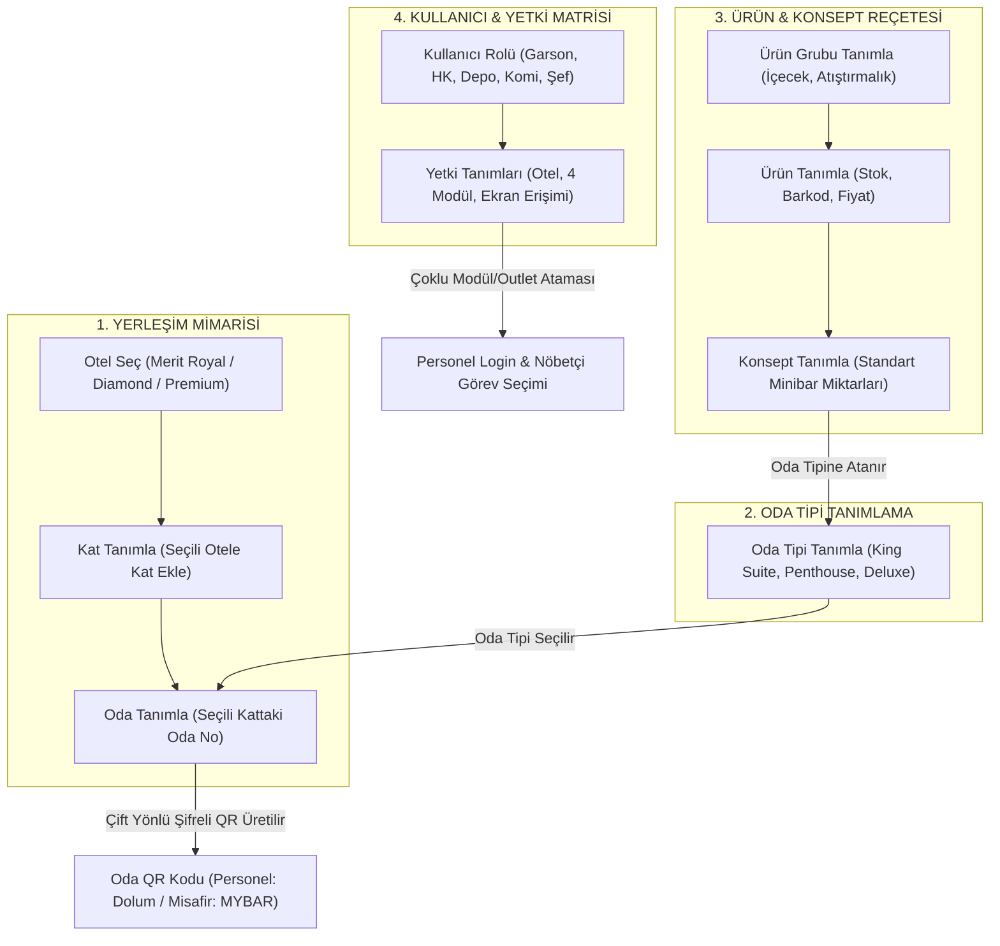

# MERIT INTERNATIONAL HOTELS & RESORTS
## Entegre Dijital Otelcilik Platformu — Teknik Mimari & Fonksiyonel Geliştirme Planı
**Teknoloji Yığını:** Next.js 15 (App Router) + PostgreSQL 16 + Prisma ORM + Tailwind CSS (Açık Kurumsal Tema) + Redis & WebSockets + ESC/POS Termal Ağ Baskı Servisi  
**Tarih:** 30 Ekim 2026  
**Doküman Sürümü:** 1.0.0-PROD  

---

## 1. Sisteme Genel Bakış ve Mimari Vizyon

Platform; **Merit Royal, Merit Royal Diamond ve Merit Crystal Rocks/Premium** yerleşkelerindeki **529 lüks oda** ve **18 yiyecek-içecek (F&B) noktasını** tek bir merkezi veritabanı ve Next.js tabanlı yüksek performanslı web uygulaması çatısı altında birleştirmektedir.

```
┌────────────────────────────────────────────────────────────────────────────────────────┐
│                                   MERIT CLOUD / ON-PREMISE CORE                        │
│                                                                                        │
│   ┌─────────────────────┐      ┌─────────────────────────┐      ┌──────────────────┐   │
│   │   Next.js 15 App    │ ───► │  Prisma ORM Client      │ ───► │  PostgreSQL 16   │   │
│   │  (Server Actions    │      │  (Type-safe Querying    │      │  (Relational DB) │   │
│   │   & React 19 RSC)   │      │   & Migrations)         │      │                  │   │
│   └──────────┬──────────┘      └─────────────────────────┘      └──────────────────┘   │
│              │                                                                         │
│              ▼                                                                         │
│   ┌─────────────────────┐      ┌─────────────────────────┐                             │
│   │   Redis Pub/Sub     │ ───► │ SSE / WebSocket Gateway │                             │
│   │  (In-Memory Cache)  │      │ (Real-time Broadcast)   │                             │
│   └─────────────────────┘      └───────────┬─────────────┘                             │
└────────────────────────────────────────────┼───────────────────────────────────────────┘
                                             │
      ┌──────────────────────────────────────┼──────────────────────────────────────┐
      │                                      │                                      │
      ▼                                      ▼                                      ▼
┌──────────────────┐               ┌──────────────────┐               ┌───────────────────┐
│  MİSAFİR ARAYÜZÜ │               │ PERSONEL & SAAT  │               │ MUTFAK & KDS &    │
│  (Mobile Web/PWA)│               │ (Garson / HK /   │               │ TERMAL YAZICI     │
│  - QR Menü       │               │  Apple Watch)    │               │ - KDS Dokunmatik  │
│  - QR Oda Servis │               │ - Sipariş Onayı  │               │ - 80mm ESC/POS    │
│  - Fiyat Gizli/  │               │ - Titreşimli Çan │               │   Termal Fiş      │
│    Açık Toggle   │               │ - Minibar Sayım  │               │   Baskı Kuyruğu   │
└──────────────────┘               └──────────────────┘               └───────────────────┘
```

### Ana Başarı Kriterleri
1. **Merkezi Fiyat Gösterme / Gizleme Sistemi:** Ana Yönetici panelinden tek tıkla hem QR Menü, hem QR Sipariş, hem de QR Oda Servisi modüllerinde fiyatların tüm misafirlere gizlenmesi veya gösterilmesi (`Global Price Visibility Toggle`).
2. **2 Kademeli Sipariş Doğrulama:** Misafir oda veya masa QR'ından sipariş verdiğinde doğrudan mutfağa düşmez; önce ilgili garsonun akıllı saatine veya PWA ekranına titreşimli bildirim düşer, garson onaylayınca mutfak KDS ve 80mm termal yazıcıya otomatik iletilir.
3. **Minibar Takip & Misafir Kişiselleştirme (Günde 1 Kez):** 529 oda için günlük tüketim, zaiyat, eksik ve şarj takibi; misafir için günde yalnızca 1 defa paket seçme hakkı (Fit & Şekersiz, Gurme Çikolata, Aile Paketi vb.) sağlayan veritabanı kısıtlaması.
4. **Donanım Bağımsızlığı & Sıfır Maliyet:** Ek donanım satın alma gereksinimi olmaksızın, mevcut personelin akıllı saatleri/telefonları, misafirin kendi cihazı ve mutfaklardaki mevcut 80mm ağ yazıcılarıyla tam uyum.

---

## 2. Proje Dizin Yapısı (Next.js 15 App Router)

```
d:/PROJELLER/qrmenu/
├── prisma/
│   ├── schema.prisma                # Veritabanı model ve ilişki tanımları
│   ├── migrations/                  # Sürüm kontrollü SQL migrasyonları
│   └── seed.ts                      # 3 Otel, 529 oda ve menü başlangıç verileri
│
├── print-gateway/                   # Termal Yazıcı Servisi (Node.js Daemon)
│   ├── daemon.js                    # ESC/POS TCP Socket 9100 & USB yazıcı dinleyicisi
│   ├── template-builder.js          # 80mm Türkçe karakterli fiş şablonu üretici
│   └── package.json
│
├── src/
│   ├── app/
│   │   ├── (admin)/                 # Master Admin Konsolu (Layout: Kurumsal Açık Tema)
│   │   │   ├── admin/
│   │   │   │   ├── dashboard/page.tsx       # KPI'lar, doluluk, sipariş hacmi
│   │   │   │   ├── hotels/page.tsx          # 3 Otel & 18 Outlet tanımları
│   │   │   │   ├── rooms/page.tsx           # 529 Oda, Kat ve Tip yönetimi
│   │   │   │   ├── menu/page.tsx            # Menü kategorileri, ürünler, alerjenler
│   │   │   │   ├── minibar-config/page.tsx  # Minibar standart reçeteleri & paketleri
│   │   │   │   ├── settings/page.tsx        # FİYAT GİZLEME/GÖSTERME TOGGLE & Sistem ayarları
│   │   │   │   └── audit-logs/page.tsx      # Sistem denetim kayıtları
│   │   │
│   │   ├── (guest)/                 # Misafir Arayüzü (Mobil Optimize PWA)
│   │   │   ├── menu/[outletSlug]/
│   │   │   │   ├── page.tsx                 # Masa/Şezlong QR Menü & Sipariş
│   │   │   │   └── cart/page.tsx            # Sepet & Garson Onay Talebi
│   │   │   ├── room-service/[token]/
│   │   │   │   └── page.tsx                 # Odaya Kilitli QR Oda Servisi
│   │   │   └── guest-minibar/[token]/
│   │   │       └── page.tsx                 # Misafir Günlük Kişiselleştirme (Günde 1x)
│   │   │
│   │   ├── (staff)/                 # Personel & Operasyon Arayüzleri
│   │   │   ├── waiter/                      # Garson Mobil PWA & Akıllı Saat Görünümü
│   │   │   │   ├── page.tsx                 # Onay bekleyen siparişler & çağrılar
│   │   │   │   └── watch/page.tsx           # Apple Watch / WearOS ultra-kompakt UI
│   │   │   ├── housekeeping/                # Kat Sorumlusu (HK) Minibar Sayım
│   │   │   │   ├── page.tsx                 # Kat ve oda bazlı minibar sayım formu
│   │   │   │   └── room/[roomId]/page.tsx   # Tekil oda eksik tamamlama & fire kaydı
│   │   │   ├── kds/                         # Mutfak Ekranı (Kitchen Display System)
│   │   │   │   └── [stationSlug]/page.tsx   # Sıcak, Soğuk, Bar, Tatlı istasyon ekranı
│   │   │   └── ird-dispatch/                # Room Service Gönderim & Kurye Paneli
│   │   │       └── page.tsx
│   │   │
│   │   ├── api/                             # REST & SSE Uç Noktaları
│   │   │   ├── real-time/
│   │   │   │   ├── waiter-events/route.ts   # SSE ile Garson/Saat anlık bildirim kanalı
│   │   │   │   └── kds-events/route.ts      # SSE ile Mutfak KDS anlık sipariş akışı
│   │   │   ├── print-queue/
│   │   │   │   └── route.ts                 # ESC/POS baskı kuyruğu webhook/poll
│   │   │   └── webhooks/
│   │   │       └── minibar-sync/route.ts
│   │   │
│   │   ├── layout.tsx                       # Genel Root Layout (Inter Font & Metadata)
│   │   └── page.tsx                         # Giriş / Yönlendirme Landing Page
│   │
│   ├── actions/                             # Next.js Server Actions (Mutasyonlar)
│   │   ├── order-actions.ts                 # Sipariş oluştur, onayla, iptal et
│   │   ├── minibar-actions.ts               # Tüketim kaydet, misafir paketi onayla
│   │   ├── settings-actions.ts              # FİYAT AÇ/KAPA merkezi toggle fonksiyonu
│   │   └── call-actions.ts                  # Garson çağır, hesap iste
│   │
│   ├── components/                          # Yeniden Kullanılabilir UI Bileşenleri
│   │   ├── ui/                              # Buton, Input, Modal, Badge (Shadcn Light)
│   │   ├── admin/                           # GlobalPriceToggle, HotelSelector, KPICard
│   │   ├── guest/                           # LuxuryItemCard, CartBar, AllergyPill
│   │   ├── waiter/                          # WatchNotificationCard, OrderApprovalCard
│   │   └── kds/                             # KdsTicket, TimerBadge, ThermalMockup
│   │
│   ├── lib/
│   │   ├── prisma.ts                        # Singleton Prisma Client örneği
│   │   ├── redis.ts                         # Redis Pub/Sub bağlantı yardımcısı
│   │   ├── auth.ts                          # JWT / Oturum & Rol yetkilendirme
│   │   ├── escpos-builder.ts                # 80mm fiş formatlayıcı binary generator
│   │   └── constants.ts                     # Oteller, durum kodları, limitler
│   │
│   └── styles/
│       └── globals.css                      # Açık Tema Renk Değişkenleri & Tailwind V4
│
├── public/
│   ├── icons/                               # PWA ikonları (apple-touch-icon, manifest)
│   ├── sounds/                              # Garson çan ve sipariş uyarı sesleri (mp3/wav)
│   └── logos/                               # Merit Royal, Diamond, Premium logoları
│
├── DESIGN.md                                # Google Stitch Tasarım Sistemi Spesifikasyonu
├── ui_prototype_stitch.html                 # 7 Ekranlı İnteraktif Açık Tema Prototipi
├── PLAN.md                                  # Bu Teknik Plan Dosyası
└── package.json
```

---

## 3. Veritabanı Modeli (`prisma/schema.prisma`)

Tam teşekküllü, 3 otel hiyerarşisini, minibar kısıtlamalarını ve merkezi fiyat göster/gizle sistemini destekleyen üretim şeması:

```prisma
datasource db {
  provider = "postgresql"
  url      = env("DATABASE_URL")
}

generator client {
  provider = "prisma-client-js"
}

// ==========================================
// 1. OTEL, KAT, ODA TİPİ VE 529 ODA HİYERARŞİSİ
// ==========================================

enum HotelCode {
  ROYAL           // Merit Royal Hotel (125 Oda) - Standart Varsayılan Kayıt
  DIAMOND         // Merit Royal Diamond Hotel (273 Oda) - Standart Varsayılan Kayıt
  PREMIUM         // Merit Royal Premium Hotel (131 Oda) - Standart Varsayılan Kayıt
}

enum OutletModuleType {
  QR_ORDER     // QR Sipariş: Masadan sipariş verme, garson çağırma, garson ön onayı
  QR_MENU      // QR Menü: Yalnızca dijital katalog & alerjen inceleme (Sipariş kapalı)
}

enum OutletPricePolicy {
  VISIBLE      // Fiyatlar görünür ($/€/₺)
  HIDDEN       // Fiyatlar tamamen gizli (All-Inclusive ikram)
  HYBRID       // Yalnızca ekstra ücretli kalemlerde fiyat görünür
}

model Hotel {
  id              String           @id @default(uuid())
  code            HotelCode        @unique
  name            String           // "Merit Royal Hotel", "Merit Royal Diamond", "Merit Royal Premium"
  totalRooms      Int              @default(0)
  isDefaultSeed   Boolean          @default(true) // 3 Otel varsayılan yüklüdür
  floors          Floor[]
  roomTypes       RoomType[]
  rooms           Room[]
  outlets         Outlet[]
  settings        SystemSetting[]
  createdAt       DateTime         @default(now())
  updatedAt       DateTime         @updatedAt
}

model Outlet {
  id              String             @id @default(uuid())
  hotelId         String
  hotel           Hotel              @relation(fields: [hotelId], references: [id], onDelete: Cascade)
  slug            String             @unique // "royal-beach-club", "zephyros-pool"
  name            String             // "Royal Beach Club & Cabana Lounge"
  moduleType      OutletModuleType   @default(QR_ORDER) // QR_ORDER veya QR_MENU
  pricePolicy     OutletPricePolicy  @default(VISIBLE)  // Opsiyonel Fiyat Politikası (Açık/Kapalı/Hibrit)
  printReceiptPrices Boolean         @default(true)     // Termal adisyonda fiyat toplamı basılsın mı?
  printerIp       String?            // "192.168.10.150:9100"
  tableCount      Int                @default(0)
  theme           String             @default("navy")   // "navy", "cyan", "gold", "rustic"
  isActive        Boolean            @default(true)
  categories      Category[]
  orders          Order[]
  staffAssocs     OutletStaffAssignment[]
  waiterAssocs    WaiterAssignment[]
  createdAt       DateTime           @default(now())
  updatedAt       DateTime           @updatedAt

  @@index([hotelId, moduleType])
}

model Floor {
  id              String           @id @default(uuid())
  hotelId         String
  hotel           Hotel            @relation(fields: [hotelId], references: [id], onDelete: Cascade)
  floorNumber     Int              // 1, 2, 3, 4, 12 (Penthouse)
  name            String           // "4. Kat", "Penthouse Katı", "Sahil Villaları Bandı"
  buildingSection String?          // "A Blok Marina", "Kule"
  rooms           Room[]
  createdAt       DateTime         @default(now())
  updatedAt       DateTime         @updatedAt

  @@unique([hotelId, floorNumber, buildingSection])
  @@index([hotelId])
}

model RoomType {
  id              String           @id @default(uuid())
  hotelId         String
  hotel           Hotel            @relation(fields: [hotelId], references: [id], onDelete: Cascade)
  name            String           // "King Suite", "Royal Penthouse", "Deluxe Marina", "Family Garden"
  squareMeters    Int?             // 145, 260, 65 vb.
  vipSegment      VipSegment       @default(STANDARD_LUXURY)
  rooms           Room[]
  concept         MinibarConcept?  // Her oda tipine özel minibar konsepti bağlanır
  createdAt       DateTime         @default(now())
  updatedAt       DateTime         @updatedAt

  @@unique([hotelId, name])
  @@index([hotelId])
}

enum VipSegment {
  STANDARD_LUXURY
  VIP_GOLD
  VVIP_PLATINUM
  AMBASSADOR_SUITE
}

model Room {
  id              String           @id @default(uuid())
  hotelId         String
  hotel           Hotel            @relation(fields: [hotelId], references: [id], onDelete: Cascade)
  floorId         String
  floor           Floor            @relation(fields: [floorId], references: [id], onDelete: Cascade)
  roomTypeId      String
  roomType        RoomType         @relation(fields: [roomTypeId], references: [id])
  conceptId       String?
  concept         MinibarConcept?  @relation(fields: [conceptId], references: [id])
  
  roomNumber      String           // "402", "1204", "Villa-02"
  currentGuest    String?          // "H. Al-Maktoum (VVIP Platinum)"
  
  // Odaya Özel Benzersiz Çift Yönlü QR Kod:
  // - Kat Personeli Okutursa ➔ Zimmetten İkame / Dolum Ekranı
  // - Misafir Okutursa ➔ Çok Dilli "MYBAR" Kişiselleştirme Ekranı
  qrSecretToken   String           @unique @default(uuid())

  minibarLogs     MinibarRefillLog[]
  myBarCustoms    MyBarCustomization[]
  dndAlarms       DNDReminderAlarm[]
  orders          Order[]
  callRequests    CallRequest[]

  createdAt       DateTime         @default(now())
  updatedAt       DateTime         @updatedAt

  @@unique([hotelId, roomNumber])
  @@index([hotelId, floorId])
}

// ==========================================
// 2. MİNİBAR ÜRÜN GRUPLARI VE ÜRÜN TANIMLARI
// ==========================================

model ProductGroup {
  id              String           @id @default(uuid())
  name            String           // "Soft Drinks & Maden Suları", "Yerli & İthal Biralar", "Gurme Çikolata"
  sortOrder       Int              @default(0)
  icon            String?          // "🥤", "🍺", "🍫", "🍾"
  products        Product[]
  createdAt       DateTime         @default(now())
  updatedAt       DateTime         @updatedAt
}

model Product {
  id              String           @id @default(uuid())
  productGroupId  String
  productGroup    ProductGroup     @relation(fields: [productGroupId], references: [id])
  name            String           // "Coca-Cola Zero 330ml", "Efes Pilsen 33cl", "Toblerone 100g"
  barcode         String?          // "8690504012345"
  stockCode       String           @unique // "MN-COLAZ-01"
  unit            String           @default("Adet")
  // Minibar takip sisteminde kesinlikle fiyat/ücret takibi yapılmaz. %100 misafir ikramıdır.
  isComplimentary Boolean          @default(true) // Her zaman ücretsiz ikram
  minAlertStock   Int              @default(50) // Depo kritik uyarı seviyesi (Adet)
  
  conceptItems    MinibarConceptItem[]
  custodyItems    TrolleyCustodyItem[]
  refillLogItems  MinibarRefillLogItem[]
  myBarItems      MyBarCustomizationItem[]

  createdAt       DateTime         @default(now())
  updatedAt       DateTime         @updatedAt

  @@index([productGroupId])
}

// ==========================================
// 3. KONSEPT TANIMLAMA (ODA TİPİNE ÖZEL REÇETELER)
// ==========================================

model MinibarConcept {
  id              String               @id @default(uuid())
  roomTypeId      String               @unique // Her oda tipinin 1 varsayılan konsepti olur
  roomType        RoomType             @relation(fields: [roomTypeId], references: [id], onDelete: Cascade)
  name            String               // "VIP King Suite Gold Konsepti", "Standart Her Şey Dahil"
  description     String?
  items           MinibarConceptItem[]
  rooms           Room[]
  createdAt       DateTime             @default(now())
  updatedAt       DateTime             @updatedAt
}

model MinibarConceptItem {
  id              String           @id @default(uuid())
  conceptId       String
  concept         MinibarConcept   @relation(fields: [conceptId], references: [id], onDelete: Cascade)
  productId       String
  product         Product          @relation(fields: [productId], references: [id])
  standardQty     Int              @default(2) // Bu odada standart bulunması gereken adet

  @@unique([conceptId, productId])
}

// ==========================================
// 4. DEPO SORUMLUSU ➔ KAT SORUMLUSU ZİMMET SİSTEMİ
// ==========================================

model WarehouseTrolleyCustody {
  id               String               @id @default(uuid())
  transferCode     String               @unique // "#ZMT-2026-881"
  warehouseStaffId String               // Kemal Usta (Depo Şefi)
  housekeeperId    String               // Ayşe Kaya (Kat Görevlisi)
  trolleyName      String               // "Diamond 4. Kat Arabası"
  issuedAt         DateTime             @default(now())
  isClosed         Boolean              @default(false)
  items            TrolleyCustodyItem[]

  @@index([housekeeperId, issuedAt])
}

model TrolleyCustodyItem {
  id               String                  @id @default(uuid())
  custodyId        String
  custody          WarehouseTrolleyCustody @relation(fields: [custodyId], references: [id], onDelete: Cascade)
  productId        String
  product          Product                 @relation(fields: [productId], references: [id])
  issuedQty        Int                     // Depodan arabaya yüklenen (Örn: 50)
  usedQty          Int                     @default(0) // Odalara ikame edilen
  wasteQty         Int                     @default(0) // Kırılan / zayiat
  returnedQty      Int                     @default(0) // Vardiya sonu depoya iade

  @@unique([custodyId, productId])
}

// ==========================================
// 5. MİNİBAR TÜKETİM, İKAME, DND VE SAHA LOGLARI
// ==========================================

enum InspectionStatus {
  COMPLETED_REFILLED
  DND_SLEEPING_PENDING  // "Misafir Uyuyor / DND"
  GUEST_ABSENT
}

model MinibarRefillLog {
  id              String               @id @default(uuid())
  roomId          String
  room            Room                 @relation(fields: [roomId], references: [id], onDelete: Cascade)
  housekeeperId   String               // İşlemi yapan kat görevlisi
  inspectionTime  DateTime             @default(now())
  status          InspectionStatus     @default(COMPLETED_REFILLED)
  notes           String?
  items           MinibarRefillLogItem[]

  @@index([roomId, inspectionTime])
}

model MinibarRefillLogItem {
  id              String           @id @default(uuid())
  logId           String
  log             MinibarRefillLog @relation(fields: [logId], references: [id], onDelete: Cascade)
  productId       String
  product         Product          @relation(fields: [productId], references: [id])
  consumedQty     Int              @default(0) // Misafirin dolaptan aldığı
  refilledQty     Int              @default(0) // Kat arabası zimmetinden yerine konan
  wasteQty        Int              @default(0) // Zayiat

  @@index([logId])
}

model DNDReminderAlarm {
  id              String           @id @default(uuid())
  roomId          String
  room            Room             @relation(fields: [roomId], references: [id], onDelete: Cascade)
  housekeeperId   String
  triggeredAt     DateTime         @default(now())
  alarmDueAt      DateTime         // Örn: +45 Dakika sonra
  isResolved      Boolean          @default(false)
  resolvedAt      DateTime?

  @@index([housekeeperId, isResolved])
}

// ==========================================
// 6. MİSAFİR "MYBAR" KİŞİSELLEŞTİRME (ÇOK DİLLİ, 1X GÜN)
// ==========================================

enum MyBarStatus {
  SUBMITTED_PENDING_HK   // Misafir gönderdi, kat görevlisi ekranında parlıyor
  FULFILLED_BY_HK        // Kat görevlisi zimmetinden ikame etti ve kapattı
  CANCELLED
}

model MyBarCustomization {
  id              String                 @id @default(uuid())
  roomId          String
  room            Room                   @relation(fields: [roomId], references: [id], onDelete: Cascade)
  requestDate     DateTime               @db.Date // YYYY-MM-DD (Günde 1 kez unique constraint)
  language        String                 @default("en") // "en", "tr", "de", "ru", "ar", "fr", "it"
  status          MyBarStatus            @default(SUBMITTED_PENDING_HK)
  fulfilledById   String?                // Talebi karşılayan kat görevlisi
  fulfilledAt     DateTime?
  items           MyBarCustomizationItem[]
  createdAt       DateTime               @default(now())

  // AYNI ODA İÇİN AYNI GÜNDE YALNIZCA 1 DEFA TALEBE İZİN VEREN KISITLAMA:
  @@unique([roomId, requestDate], name: "unique_mybar_room_per_day")
  @@index([roomId, requestDate])
}

model MyBarCustomizationItem {
  id              String             @id @default(uuid())
  myBarId         String
  myBar           MyBarCustomization @relation(fields: [myBarId], references: [id], onDelete: Cascade)
  productId       String
  product         Product            @relation(fields: [productId], references: [id])
  deltaQty        Int                // +2 (istenen ilave) veya -2 (çıkarılan ürün)

  @@index([myBarId])
}

// ==========================================
// 2. MERKEZİ FİYAT VE SİSTEM AYARLARI
// ==========================================

enum PriceDisplayMode {
  SHOW_ALL         // Fiyatlar görünür
  HIDE_ALL         // Fiyatlar tamamen gizli (Lüks Her Şey Dahil / İkram Modu)
  SHOW_PAID_ONLY   // Sadece ekstra ücrete tabi olanlarda fiyat göster
}

model SystemSetting {
  id               String           @id @default(uuid())
  hotelId          String?          // null ise tüm kompleks için genel ayar
  hotel            Hotel?           @relation(fields: [hotelId], references: [id])
  key              String           @unique // "PRICE_VISIBILITY_MODE"
  priceMode        PriceDisplayMode @default(SHOW_ALL)
  currencySymbol   String           @default("$")
  autoPrintReceipt Boolean          @default(true)
  updatedBy        String?
  updatedAt        DateTime         @updatedAt
}

// ==========================================
// 3. MİSTAFİR VE PERSONEL YETKİLERİ
// ==========================================

enum UserRole {
  SUPER_ADMIN
  HOTEL_MANAGER
  FB_DIRECTOR
  CHEF_KITCHEN
  WAITER
  HOUSEKEEPING
  ROOM_SERVICE_COORDINATOR
  WAREHOUSE_KEEPER
  BUTLER
}

enum StaffSessionStatus {
  ONLINE          // Aktif nöbetçi, çağrı ve sipariş bildirimlerini anlık alıyor
  ON_BREAK        // MOLA durumunda (Bildirimler geçici askıya alınır, diğer personele yönlendirilir)
  IDLE            // Hareketsiz / İnaktif (45 dk sınırı dolunca uyarılır)
  AUTO_LOGOUT     // Süre / Vardiya aşımıyla otomatik kapatılan oturum
  LOGGED_OUT      // Kullanıcının kendi isteğiyle çıkış yaptığı durum
}

model User {
  id             String                   @id @default(uuid())
  username       String                   @unique
  passwordHash   String
  fullName       String
  role           UserRole
  hotelId        String?
  phone          String?
  isActive       Boolean                  @default(true)
  assignments    WaiterAssignment[]
  outletAssocs   OutletStaffAssignment[]
  sessions       StaffSession[]
  ordersApproved Order[]                  @relation("ApprovedOrders")
  createdAt      DateTime                 @default(now())
  updatedAt      DateTime                 @updatedAt
}

model OutletStaffAssignment {
  id          String    @id @default(uuid())
  userId      String
  user        User      @relation(fields: [userId], references: [id], onDelete: Cascade)
  outletId    String
  outlet      Outlet    @relation(fields: [outletId], references: [id], onDelete: Cascade)
  moduleType  String    // "QR_ORDER", "QR_MENU", "IRD", "MINIBAR"
  roleTitle   String    // "Servis Garsonu", "Barista", "Butler Şefi", "Kat Şefi"
  isPrimary   Boolean   @default(false)
  createdAt   DateTime  @default(now())

  @@unique([userId, outletId, moduleType])
}

model StaffSession {
  id              String             @id @default(uuid())
  userId          String
  user            User               @relation(fields: [userId], references: [id], onDelete: Cascade)
  hotelId         String
  outletId        String
  deviceType      String?            // "Apple Watch Series 9", "Samsung XCover6", "iPhone 15 Pro"
  status          StaffSessionStatus @default(ONLINE)
  loginAt         DateTime           @default(now())
  lastActivityAt  DateTime           @default(now())
  maxShiftMinutes Int                @default(480) // 8 saat
  idleTimeoutMin  Int                @default(45)  // 45 dk hareketsizlik
  logoutAt        DateTime?
  logoutReason    String?            // "USER_LOGOUT", "INACTIVITY_TIMEOUT", "MAX_SHIFT_EXCEEDED", "ADMIN_FORCED"
  createdAt       DateTime           @default(now())
  updatedAt       DateTime           @updatedAt

  @@index([hotelId, outletId, status])
  @@index([userId, status])
}

model WaiterAssignment {
  id        String   @id @default(uuid())
  userId    String
  user      User     @relation(fields: [userId], references: [id], onDelete: Cascade)
  outletId  String
  outlet    Outlet   @relation(fields: [outletId], references: [id], onDelete: Cascade)
  active    Boolean  @default(true)
  createdAt DateTime @default(now())

  @@unique([userId, outletId])
}

// ==========================================
// 4. MENÜ VE ÜRÜN YÖNETİMİ
// ==========================================

model Category {
  id          String      @id @default(uuid())
  outletId    String
  outlet      Outlet      @relation(fields: [outletId], references: [id], onDelete: Cascade)
  parentId    String?     // Alt Kategori & Menü Grubu Hiyerarşisi (Self-relation)
  parent      Category?   @relation("SubCategories", fields: [parentId], references: [id], onDelete: Cascade)
  children    Category[]  @relation("SubCategories")
  name        String      // "İmza Kokteyller", "Spritz Collection", "Prestige Champagne"
  sortOrder   Int         @default(0)
  imageUrl    String?     // Kategoriye özel kapak görseli
  items       MenuItem[]
  createdAt   DateTime    @default(now())
  updatedAt   DateTime    @updatedAt

  @@index([outletId, sortOrder])
  @@index([parentId])
}

model MenuItem {
  id              String       @id @default(uuid())
  categoryId      String
  category        Category     @relation(fields: [categoryId], references: [id], onDelete: Cascade)
  name            String
  description     String?
  price           Decimal      @db.Decimal(10, 2)
  isComplimentary Boolean      @default(false) // Fiyat gösterilse bile ikram olanlar
  prepTimeMinutes Int          @default(15)
  kitchenStation  KitchenStation @default(HOT_KITCHEN)
  allergens       String[]     // ["GLUTEN", "NUTS", "DAIRY"]
  calories        Int?
  imageUrl        String?
  isAvailable     Boolean      @default(true)
  orderItems      OrderItem[]
  createdAt       DateTime     @default(now())
  updatedAt       DateTime     @updatedAt

  @@index([categoryId])
}

enum KitchenStation {
  HOT_KITCHEN
  COLD_KITCHEN
  PASTRY
  MAIN_BAR
  ROOM_SERVICE_PACKING
}

// ==========================================
// 5. SİPARİŞ VE 2 KADEMELİ ONAY SİSTEMİ
// ==========================================

enum OrderStatus {
  PENDING_WAITER_APPROVAL // Misafir gönderdi, Garson/Saat ekranında bekliyor
  APPROVED_SENT_TO_KITCHEN// Garson onayladı, KDS'e düştü ve fiş basıldı
  PREPARING               // Mutfak hazırlığa başladı
  READY_FOR_SERVICE       // Mutfak tamamladı, garson servise aldı
  DELIVERED               // Masaya / Odaya teslim edildi
  CANCELLED               // Hatalı veya iptal sipariş
}

model Order {
  id              String       @id @default(uuid())
  outletId        String
  outlet          Outlet       @relation(fields: [outletId], references: [id])
  roomId          String?      // Oda servisi ise dolu, açık mekan ise null
  room            Room?        @relation(fields: [roomId], references: [id])
  tableNumber     String?      // Masa 14, Cabana 03 vb.
  orderNumber     Int          @default(autoincrement())
  status          OrderStatus  @default(PENDING_WAITER_APPROVAL)
  totalAmount     Decimal      @default(0.00) @db.Decimal(10, 2)
  isPricesHidden  Boolean      @default(false) // Sipariş anındaki fiyat gizleme durumu
  guestNotes      String?
  
  approvedById    String?
  approvedBy      User?        @relation("ApprovedOrders", fields: [approvedById], references: [id])
  approvedAt      DateTime?

  items           OrderItem[]
  createdAt       DateTime     @default(now())
  updatedAt       DateTime     @updatedAt

  @@index([outletId, status])
  @@index([roomId])
}

model OrderItem {
  id          String    @id @default(uuid())
  orderId     String
  order       Order     @relation(fields: [orderId], references: [id], onDelete: Cascade)
  menuItemId  String
  menuItem    MenuItem  @relation(fields: [menuItemId], references: [id])
  quantity    Int       @default(1)
  unitPrice   Decimal   @db.Decimal(10, 2)
  notes       String?   // "Buzsuz, orta pişmiş" vb.

  @@index([orderId])
}

// ==========================================
// 6. ÇAĞRI VE AKILLI SAAT BİLDİRİMLERİ
// ==========================================

enum CallType {
  ORDER_APPROVAL_REQUEST  // "Masa 14 Yeni Sipariş Verdi"
  WAITER_CALL             // "Masa 08 Garson Çağırıyor"
  BILL_REQUEST            // "Masa 08 Hesap İstiyor"
  ROOM_SERVICE_INQUIRY    // "Oda 402 Teyit İstiyor"
}

model CallRequest {
  id          String     @id @default(uuid())
  roomId      String?
  room        Room?      @relation(fields: [roomId], references: [id])
  tableNumber String?
  outletId    String
  callType    CallType
  isResolved  Boolean    @default(false)
  resolvedBy  String?
  createdAt   DateTime   @default(now())
  resolvedAt  DateTime?

  @@index([outletId, isResolved])
}

// ==========================================
// 7. MİNİBAR VE GÜNLÜK KİŞİSELLEŞTİRME
// ==========================================

model MinibarItem {
  id           String            @id @default(uuid())
  name         String            // "Efes Pilsen 33cl", "Perrier 250ml", "Snickers"
  category     String            // "Bira", "Soft Drink", "Atıştırmalık"
  standardQty  Int               @default(2) // Odadaki standart stok adedi
  unitPrice    Decimal           @db.Decimal(10, 2)
  logs         MinibarRefillLogItem[]
  createdAt    DateTime          @default(now())
}

model MinibarRefillLog {
  id          String               @id @default(uuid())
  roomId      String
  room        Room                 @relation(fields: [roomId], references: [id], onDelete: Cascade)
  staffId     String               // Kat görevlisi ID
  inspectedAt DateTime             @default(now())
  notes       String?
  items       MinibarRefillLogItem[]

  @@index([roomId, inspectedAt])
}

model MinibarRefillLogItem {
  id           String            @id @default(uuid())
  logId        String
  log          MinibarRefillLog  @relation(fields: [logId], references: [id], onDelete: Cascade)
  minibarItemId String
  minibarItem  MinibarItem       @relation(fields: [minibarItemId], references: [id])
  consumedQty  Int               @default(0) // Misafirin tükettiği adet
  refilledQty  Int               @default(0) // Görevlinin yerine koyduğu
  wasteQty     Int               @default(0) // Kırılan / son kullanma tarihi geçmiş

  @@index([logId])
}

// Misafir Günde Yalnızca 1 Defa Paket Değiştirebilir Kısıtlaması
model MinibarCustomization {
  id            String   @id @default(uuid())
  roomId        String
  room          Room     @relation(fields: [roomId], references: [id], onDelete: Cascade)
  packageType   String   // "FIT_SUGARFREE", "GOURMET_CHOCOLATE", "FAMILY_SNACK"
  requestDate   DateTime @db.Date // YYYY-MM-DD formatında (Günde 1 kez constraint)
  notes         String?
  isCompleted   Boolean  @default(false)
  createdAt     DateTime @default(now())

  // AYNI ODA İÇİN AYNI TARİHTE YALNIZCA 1 KAYIT OLABİLİR:
  @@unique([roomId, requestDate], name: "unique_room_date_customization")
  @@index([roomId, requestDate])
}
```

---

## 4. Kritik Server Action ve Fonksiyon Mantıkları

### 4.1. Fiyat Göster / Gizle Merkezi Fonksiyonu (`src/actions/settings-actions.ts`)
Yönetici panelinden fiyat durumu değiştirildiğinde tüm misafir ekranlarında anında yansımasını sağlayan fonksiyon:

```typescript
"use server";

import { prisma } from "@/lib/prisma";
import { revalidatePath } from "next/cache";
import { redis } from "@/lib/redis";
import { PriceDisplayMode } from "@prisma/client";

export async function toggleGlobalPriceVisibility(
  mode: PriceDisplayMode,
  hotelId?: string
) {
  try {
    const updatedSetting = await prisma.systemSetting.upsert({
      where: { key: "PRICE_VISIBILITY_MODE" },
      update: { priceMode: mode, hotelId: hotelId || null },
      create: {
        key: "PRICE_VISIBILITY_MODE",
        priceMode: mode,
        hotelId: hotelId || null,
      },
    });

    // Redis Pub/Sub üzerinden tüm bağlı misafir istemcilerine anlık bildirim fırlat
    await redis.publish(
      "system:settings",
      JSON.stringify({
        event: "PRICE_VISIBILITY_CHANGED",
        mode,
        hotelId,
      })
    );

    // İlgili Next.js sayfa cache'lerini temizle
    revalidatePath("/menu/[outletSlug]", "page");
    revalidatePath("/room-service/[token]", "page");
    revalidatePath("/admin/settings", "page");

    return { success: true, mode: updatedSetting.priceMode };
  } catch (error) {
    console.error("Fiyat görünürlüğü güncellenirken hata oluştu:", error);
    return { success: false, error: "Ayar kaydedilemedi." };
  }
}
```

### 4.2. 2 Kademeli Sipariş Doğrulama & Garson Onay Akışı (`src/actions/order-actions.ts`)

```typescript
"use server";

import { prisma } from "@/lib/prisma";
import { redis } from "@/lib/redis";
import { OrderStatus } from "@prisma/client";
import { dispatchToThermalPrinter } from "@/lib/escpos-builder";

// Adım 1: Misafir Siparişi Oluşturur (Durum: PENDING_WAITER_APPROVAL)
export async function createGuestOrder(params: {
  outletId: string;
  tableNumber?: string;
  roomId?: string;
  guestNotes?: string;
  items: { menuItemId: string; quantity: number; notes?: string }[];
}) {
  const currentPriceSetting = await prisma.systemSetting.findUnique({
    where: { key: "PRICE_VISIBILITY_MODE" },
  });
  const isHidden = currentPriceSetting?.priceMode === "HIDE_ALL";

  // Veritabanında siparişi ve satırlarını oluştur
  const order = await prisma.order.create({
    data: {
      outletId: params.outletId,
      tableNumber: params.tableNumber,
      roomId: params.roomId,
      guestNotes: params.guestNotes,
      status: OrderStatus.PENDING_WAITER_APPROVAL,
      isPricesHidden: isHidden,
      items: {
        create: await Promise.all(
          params.items.map(async (item) => {
            const menuItem = await prisma.menuItem.findUniqueOrThrow({
              where: { id: item.menuItemId },
            });
            return {
              menuItemId: item.menuItemId,
              quantity: item.quantity,
              unitPrice: menuItem.price,
              notes: item.notes,
            };
          })
        ),
      },
    },
    include: { items: { include: { menuItem: true } } },
  });

  // Garsonların akıllı saatlerine & PWA'ya titreşimli bildirim gönder
  await redis.publish(
    `outlet:${params.outletId}:waiters`,
    JSON.stringify({
      type: "ORDER_APPROVAL_REQUEST",
      orderId: order.id,
      tableNumber: params.tableNumber || `Oda ${params.roomId}`,
      itemCount: order.items.length,
      createdAt: order.createdAt,
    })
  );

  return { success: true, orderId: order.id };
}

// Adım 2: Garson Siparişi Onaylar (KDS'e Düşer ve Termal Yazıcı Fiş Basar)
export async function approveOrder(orderId: string, waiterUserId: string) {
  const approvedOrder = await prisma.order.update({
    where: { id: orderId },
    data: {
      status: OrderStatus.APPROVED_SENT_TO_KITCHEN,
      approvedById: waiterUserId,
      approvedAt: new Date(),
    },
    include: {
      outlet: true,
      items: { include: { menuItem: true } },
    },
  });

  // 1. Mutfak KDS ekranlarına anlık gönderim
  await redis.publish(
    `outlet:${approvedOrder.outletId}:kds`,
    JSON.stringify({
      event: "NEW_APPROVED_ORDER",
      order: approvedOrder,
    })
  );

  // 2. Mutfaktaki 80mm ESC/POS Termal Ağ Yazıcısına Fiş İletimi
  if (approvedOrder.outlet.printerIp) {
    await dispatchToThermalPrinter(approvedOrder.outlet.printerIp, approvedOrder);
  }

  return { success: true };
}
```

### 4.3. Misafir Minibar Günde 1 Kez Kişiselleştirme (`src/actions/minibar-actions.ts`)

```typescript
"use server";

import { prisma } from "@/lib/prisma";

export async function requestMinibarCustomization(
  roomId: string,
  packageType: string,
  notes?: string
) {
  // Bugünün YYYY-MM-DD tarihini al (saatsiz)
  const today = new Date();
  today.setHours(0, 0, 0, 0);

  try {
    const record = await prisma.minibarCustomization.create({
      data: {
        roomId,
        packageType,
        requestDate: today,
        notes,
      },
    });

    return {
      success: true,
      message: "Paket talebiniz kat şefine iletildi. Bugün saat 17:00'ye kadar dolum tamamlanacaktır.",
      data: record,
    };
  } catch (error: any) {
    // Prisma P2002 hatası: Unique constraint ihlali (unique_room_date_customization)
    if (error.code === "P2002") {
      return {
        success: false,
        error: "Günde yalnızca 1 defa minibar paketi seçimi yapabilirsiniz. Yarın tekrar talep oluşturabilirsiniz.",
      };
    }
    return { success: false, error: "İşlem sırasında bir hata oluştu." };
  }
}
```

---

## 5. Gerçek Zamanlı Akıllı Saat & KDS İletişimi (SSE / WebSocket)

Mevcut akıllı saatler (Apple Watch, WearOS veya personelin akıllı telefonları) için ek bir native uygulama zorunluluğu olmaksızın **Web Push API**, **Service Worker Vibration API** ve **Server-Sent Events (SSE)** mimarisi kullanılır:

```
[Misafir Siparişi Verir]
         │
         ▼
[Server Action -> Redis Pub/Sub]
         │
         ▼
[SSE Route: /api/real-time/waiter-events]
         │ (Sub-second push)
         ▼
[Garson PWA / Apple Watch Safari]
         │
         ├─► navigator.vibrate([200, 100, 200, 100, 400])  // Haptik Titreşim
         ├─► AudioContext: Sesli Çan ("ding-ding.mp3")
         └─► Ekranda Kırmızı Kayan Kart: "MASA 14 SİPARİŞİ ONAYLA"
```

---

## 6. ESC/POS Yerel Termal Yazıcı Servisi (`print-gateway/daemon.js`)

Mutfak ve barlarda kullanılan 80mm Epson/Bixolon/Star termal ağ yazıcıları için doğrudan TCP 9100 portu üzerinden çalışan hafif Node.js baskı kuyruğu:

```javascript
// print-gateway/daemon.js
const net = require("net");
const iconv = require("iconv-lite");

function printReceipt(printerIp, orderData) {
  return new Promise((resolve, reject) => {
    const client = new net.Socket();
    client.setTimeout(3000);

    client.connect(9100, printerIp, () => {
      let buffer = Buffer.concat([
        Buffer.from([0x1B, 0x40]), // Init printer
        Buffer.from([0x1B, 0x61, 0x01]), // Center align
        Buffer.from([0x1D, 0x21, 0x11]), // Double height & width
        iconv.encode("MERIT ROYAL HOTELS\n", "cp857"),
        Buffer.from([0x1D, 0x21, 0x00]), // Normal font
        iconv.encode("------------------------------------------\n", "cp857"),
        iconv.encode(`SIPARIS NO: #${orderData.orderNumber} | MASA: ${orderData.tableNumber}\n`, "cp857"),
        iconv.encode(`ZAMAN: ${new Date().toLocaleTimeString("tr-TR")}\n`, "cp857"),
        iconv.encode("------------------------------------------\n", "cp857"),
        Buffer.from([0x1B, 0x61, 0x00]), // Left align
      ]);

      // Kalemleri ekle
      orderData.items.forEach((item) => {
        const line = `${item.quantity}x ${item.menuItem.name}\n`;
        buffer = Buffer.concat([buffer, iconv.encode(line, "cp857")]);
        if (item.notes) {
          buffer = Buffer.concat([buffer, iconv.encode(`  * NOT: ${item.notes}\n`, "cp857")]);
        }
      });

      // Fiş kesme komutu
      buffer = Buffer.concat([
        buffer,
        iconv.encode("\n\n\n------------------------------------------\n", "cp857"),
        Buffer.from([0x1D, 0x56, 0x41, 0x03]), // Full cut
      ]);

      client.write(buffer, () => {
        client.end();
        resolve(true);
      });
    });

    client.on("error", (err) => {
      console.error(`Yazıcı bağlantı hatası (${printerIp}):`, err.message);
      reject(err);
    });
  });
}

module.exports = { printReceipt };
```

### 4.5. Personel Oturum, Çoklu Outlet Nöbeti ve Otomatik Logout Motoru (`src/actions/staff-session-actions.ts`)
Sisteme giriş yapan personelin atanmış yetkili outletini seçerek ONLINE duruma geçmesini, maksimum oturum süresini ve hareketsizlik zaman aşımını yöneten Server Action ve Cron Handler mimarisi:

```typescript
"use server";

import { prisma } from "@/lib/prisma";
import { redis } from "@/lib/redis";
import { StaffSessionStatus } from "@prisma/client";

// 1. Personel Girişi ve Aktif Outlet Seçimi
export async function loginAndSelectOutlet({
  userId,
  hotelId,
  outletId,
  deviceType
}: {
  userId: string;
  hotelId: string;
  outletId: string;
  deviceType?: string;
}) {
  // Outlet yetkisini doğrula
  const assignment = await prisma.outletStaffAssignment.findFirst({
    where: { userId, outletId }
  });

  if (!assignment) {
    throw new Error("Bu personelin seçilen outlette çalışma yetkisi bulunmamaktadır.");
  }

  // Varsa önceki açık oturumları sonlandır
  await prisma.staffSession.updateMany({
    where: { userId, status: { in: ["ONLINE", "IDLE"] } },
    data: { status: "LOGGED_OUT", logoutAt: new Date(), logoutReason: "NEW_LOGIN_SESSION" }
  });

  // Yeni oturum oluştur
  const session = await prisma.staffSession.create({
    data: {
      userId,
      hotelId,
      outletId,
      deviceType: deviceType || "Web PWA",
      status: "ONLINE",
      maxShiftMinutes: 480, // 8 saat
      idleTimeoutMin: 45    // 45 dakika
    },
    include: { user: true, outlet: true }
  });

  // Redis telemetry cache güncelle (Canlı Monitör ve SSE için)
  await redis.hset(`staff:online:${session.id}`, {
    sessionId: session.id,
    userId,
    fullName: session.user.fullName,
    outletId,
    status: "ONLINE",
    lastHeartbeat: Date.now()
  });

  // SSE Bildirimi: Yönetici Telemetri Radarına Aktar
  await redis.publish("staff:telemetry", JSON.stringify({
    event: "STAFF_ONLINE",
    userId,
    userName: session.user.fullName,
    outletId,
    hotelId
  }));

  return { success: true, sessionId: session.id };
}

// 2. Kalp Atışı (Heartbeat) & Hareketsizlik Güncellemesi
export async function heartbeatStaffActivity(sessionId: string) {
  const session = await prisma.staffSession.findUnique({ where: { id: sessionId } });
  if (!session || session.status === "LOGGED_OUT" || session.status === "AUTO_LOGOUT") {
    return { valid: false, message: "Oturum sonlandırılmış." };
  }

  const now = new Date();
  const shiftDurationMin = (now.getTime() - session.loginAt.getTime()) / (1000 * 60);

  // 8 Saatlik vardiya aşımı kontrolü
  if (shiftDurationMin >= session.maxShiftMinutes) {
    await prisma.staffSession.update({
      where: { id: sessionId },
      data: { status: "AUTO_LOGOUT", logoutAt: now, logoutReason: "MAX_SHIFT_EXCEEDED" }
    });
    await redis.del(`staff:online:${sessionId}`);
    return { valid: false, message: "Maksimum 8 saatlik vardiya süreniz doldu. Otomatik çıkış yapıldı." };
  }

  // Aktifliği tazele
  await prisma.staffSession.update({
    where: { id: sessionId },
    data: { lastActivityAt: now, status: "ONLINE" }
  });

  await redis.hset(`staff:online:${sessionId}`, "lastHeartbeat", Date.now());
  return { valid: true };
}

// 3. Arka Plan Otomatik Logout Daemon (Cron Job - Dakikada Bir Çalışır)
export async function runAutoLogoutDaemon() {
  const now = new Date();
  const threshold45MinAgo = new Date(now.getTime() - 45 * 60 * 1000);
  const threshold8HoursAgo = new Date(now.getTime() - 8 * 60 * 60 * 1000);

  // A) 45 Dk hareketsiz kalanları tespit et
  const idleSessions = await prisma.staffSession.updateMany({
    where: {
      status: "ONLINE",
      lastActivityAt: { lt: threshold45MinAgo }
    },
    data: {
      status: "AUTO_LOGOUT",
      logoutAt: now,
      logoutReason: "INACTIVITY_TIMEOUT"
    }
  });

  // B) 8 saati aşan personelleri zorunlu logout yap
  const shiftExpiredSessions = await prisma.staffSession.updateMany({
    where: {
      status: { in: ["ONLINE", "IDLE"] },
      loginAt: { lt: threshold8HoursAgo }
    },
    data: {
      status: "AUTO_LOGOUT",
      logoutAt: now,
      logoutReason: "MAX_SHIFT_EXCEEDED"
    }
  });

  return { idleTerminated: idleSessions.count, shiftTerminated: shiftExpiredSessions.count };
}
```

---


### 4.6. Hiyerarşik Tanımlama Akışı ve Mola Yönetim Yaşam Döngüsü

#### A. Hiyerarşik Tanımlama ve Veri Akışı


#### B. Personel Nöbet ve Mola (ON_BREAK) Yaşam Döngüsü
1. **Login & Nöbet Seçimi:** Kullanıcı sisteme girdiğinde yetkili olduğu otel ve aktif outletini seçer. Durumu `ONLINE` olur.
2. **Mola Talebi (`ON_BREAK`):** Personel molaya çıktığında arayüzden veya akıllı saatinden "Mola" butonuna basar.
   * Redis üzerindeki `staff:online:{sessionId}` kaydında durum `ON_BREAK` yapılır.
   * Masalardan gelen garson çağrıları veya minibar ikmal uyarıları bu personele iletilmez; nöbetteki diğer `ONLINE` personellere yönlendirilir.
3. **Moladan Dönüş:** Personel molasını tamamlayıp göreve başladığında tek dokunuşla `ONLINE` durumuna geri döner.
4. **Maksimum Vardiya / Hareketsizlik:** 45 dakika işlem yapılmazsa sistem önce uyarır, yanıt alınamazsa veya 8 saatlik vardiya sınırı aşılırsa `AUTO_LOGOUT` çalışır.

---


### 4.7. Windows XP Masaüstü & Android Hibrit Mimari Tasarımı

Sistem Yöneticisi için geliştirilen kurumsal işletim sistemi arayüzü ve mobil terminal yaşam döngüsü:

1. **Windows XP Desktop & Tablet Modu (Default: Full Yetki):**
   * **Pencere Yöneticisi (Window Manager):** Sürüklenebilir (Draggable), büyütülebilir/küçültülebilir pencereler. Çift tıklama ile açılır.
   * **Başlat Menüsü & Görev Çubuğu:** Aktif pencereler görev çubuğunda listelenir. Başlat menüsünden masaüstüne sürükle-bırak kısayol atanabilir.
   * **Masaüstü Context Menu:** Sağ tıklandığında Yenile ve Duvar Kağıdı (Bliss, Klasik Mavi, Gümüş, Royal Gold) değiştirme seçenekleri sunulur.
   * **CRUD & Onay Protokolü:** Veritabanını etkileyen her işlemde (silme, yetki verme, adisyon basma vb.) yerel Windows XP tarzı Confirm Dialog çalıştırılır.

2. **Android Mobil Terminal Modu (Monitoring & Yetki Koruması):**
   * **Varsayılan Güvenlik Kuralı:** Mobil cihazlarda mimari tanımlamalar kilitlidir. Yalnızca Canlı Radar Monitörü, DSS Tüketim Raporları ve Nöbetçi Personel Takip ekranları görüntülenir.
   * **Ayarlar Yetki Switchboard:** Sistem Yöneticisi Masaüstünden `chk-mobile-def-permission` anahtarını açtığında, mobil cihazlarda da tanımlama ekranları çift yönlü olarak aktif hale gelir.

3. **Çoklu Otel & Çoklu Modül İzolasyonu:**
   * Her modül (QR Menü, QR Sipariş, IRD, Minibar) ayrı bir bağımsız işletim birimi; her otel ise kendi içinde izole bir operasyon olarak çalışır.

---

## 7. Aşamalı Geliştirme Yol Haritası & Teslim Takvimi (30 Gün)

| Faz | Süre | Görevler & Çıktılar | Doğrulama & Kontrol Noktası |
|---|---|---|---|
| **Faz 1: Çekirdek & Veritabanı** | 1–5. Gün | PostgreSQL kurulumu, Prisma şema migrasyonu, seed verileri (Merit Royal 529 oda, 18 outlet ve menü ağacı) | `npx prisma migrate dev` ve veritabanı studio testi |
| **Faz 2: Master Admin & Ayarlar** | 6–11. Gün | Açık tema Next.js 15 dashboard, **Fiyat Göster/Gizle merkezi toggle**, oda & menü yönetim ekranları | Toggle tıklandığında anlık veritabanı revalidation teyidi |
| **Faz 3: Misafir QR Deneyimi** | 12–17. Gün | QR Menü & Sipariş mobil PWA, QR Oda Servisi, Minibar günde 1x paket seçim ekranı | Canlı mobil test: Fiyat toggle kapalıyken 0-fiyat deneyimi |
| **Faz 4: Garson & Akıllı Saat** | 18–22. Gün | PWA Garson konsolu, Apple Watch ekranı, titreşimli bildirimler, 2 kademeli onay mekanizması | Masa QR sipariş -> Garson Apple Watch anlık titreşim teyidi |
| **Faz 5: KDS & ESC/POS Yazıcı** | 23–26. Gün | Mutfak ekranları, 80mm ağ yazıcısı daemon entegrasyonu, termal fiş çıktısı formatlama | Sipariş onaylandığında fiziksel termal yazıcıdan fiş basımı |
| **Faz 6: Yerinde Kurulum & Canlı Test** | 27–30. Gün | KKTC yerleşkesinde 3 otelde Wi-Fi & tablet/saat uyum testleri, personel eğitimi, canlıya alma | 3 Otel, 529 oda tam faal operasyon onayı |

---

## 8. İlgili Belgeler & Prototip Referansları
- **Google Stitch Tasarım Sistemi:** [DESIGN.md](file:///d:/PROJELLER/qrmenu/DESIGN.md)
- **7 Ekranlı İnteraktif Açık Tema Prototipi:** [ui_prototype_stitch.html](file:///d:/PROJELLER/qrmenu/ui_prototype_stitch.html)
- **Kurumsal Fiyat Teklifi ve Şartname:** [merit_proforma_teklif_sartname.html](file:///d:/PROJELLER/qrmenu/merit_proforma_teklif_sartname.html) | [merit_proforma_teklif_sartname.pdf](file:///d:/PROJELLER/qrmenu/merit_proforma_teklif_sartname.pdf)
- **Kapsamlı Karşılaştırma Matrisi & Rapor:** [index.html](file:///d:/PROJELLER/qrmenu/index.html)
