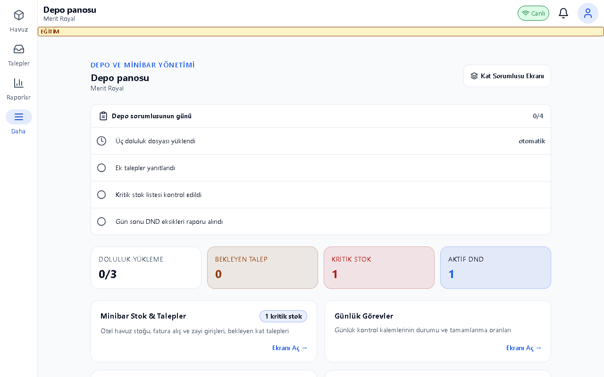
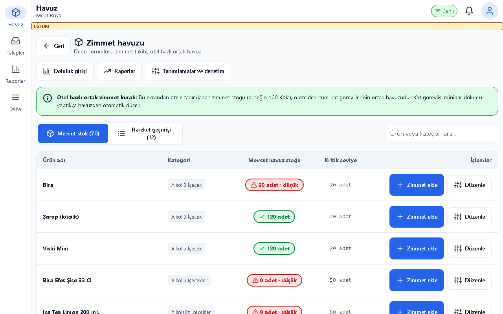
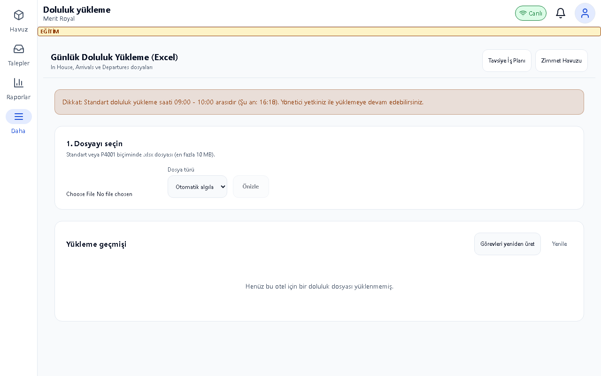
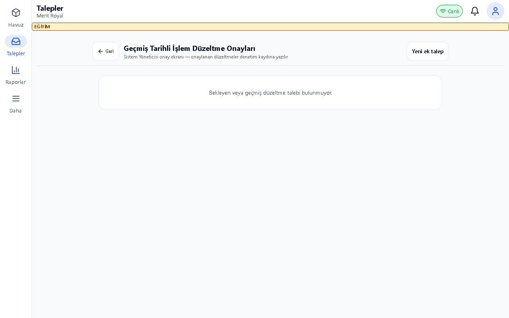
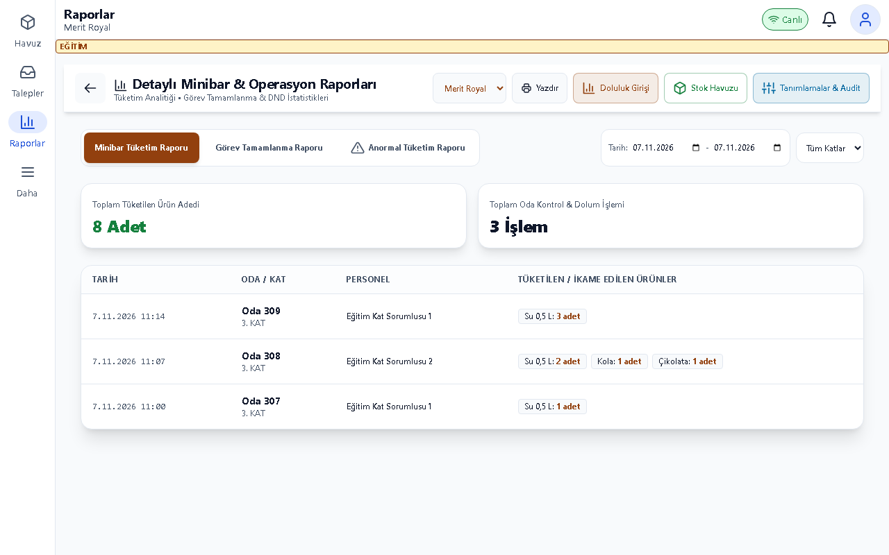
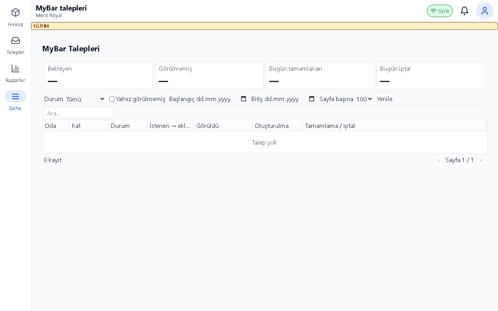

# Depo Kılavuzu

## Bu kılavuz kimin için

Zimmet havuzu, doluluk yüklemesi ve minibar taleplerini yöneten depo personeli.

## Giriş

Eğitim ortamının adresini sorumlunuzdan alın; kurulum için [Kurulum kılavuzu](../kurulum.md) kullanılır. Bu belgedeki görüntüler ayrı eğitim veritabanındaki örnek verilerden alınmıştır. Gerçek kullanıcı/parola içermez.

Eğitim hesabı: egitim.depo. Parolayı eğitim sorumlusu paylaşır; bu belgeye yazılmaz. Personel girişinde kullanıcı adı ve size verilen parola ile Giriş Yap düğmesine dokunun. Otel/hedef seçimi açılırsa doğru oteli ve çalışma yerini seçin. İş sonunda profil menüsünden çıkış yapın.

## Günlük işler

1. **Depo panosu**: Doğru oteli seçin. Kritik stok, talepler ve günlük görev durumlarını vardiya başında kontrol edin.

2. **Zimmet Havuzu**: Ürünü seçin, giriş/iade işleminin yönünü ve adedini doğrulayın. Giriş havuzu artırır; iade havuzdan çıkışı gösterir. Açıklamayı yazıp onayı okuyun. Kritik seviye eşiğini güncel tutun. Serbest düzeltme yalnız sistem yöneticisindedir; eksi bakiye oluşturmayın.

3. **Doluluk Yükleme**: Otel ve iş gününü seçin. In House, Arrivals ve Departures Excel dosyalarını eşleştirin. Önizlemede tanınmayan oda/hatalı satırları düzeltin; üç dosyanın günü uyumlu olmalıdır. Yüklemenin ardından oluşan görevleri ve öncelik planını kontrol edin.

4. **Düzeltme ve Ek Talepler**: Bekleyen talebi, oda/ürün/adet ve açıklamasıyla okuyun. Yetkiniz dahilinde onaylayın; teslimi gerçekten yapınca kaydedin. Onay ile fiziksel teslim farklı adımlardır.

5. **Minibar Raporları**: Otel ve tarih süzgecini doğrulayın. Tüketim, görev ve DND raporlarını inceleyin; havuz hareketiyle tüketim toplamını karşılaştırın. Gün sonu eksik odaları kat sorumlusuyla değerlendirin.

6. **MyBar Talepleri**: Açık talebi oda ve durumuyla kontrol edin. İptal gerekiyorsa gerekçeyi yazıp onaylayın. Tamamlanmış talebi yeniden teslim etmeyin; misafire durumu saha sorumlusu üzerinden bildirin.

## Sık sorunlar

| Sorun | Çözüm |
|---|---|
| Excel satırı tanınmıyor | Dosyanın oda numarası ve başlıklarını, doğru oteli ve tarihi kontrol edin. |
| Görev sayısı beklenenden farklı | Üç dosyayı ve aynı odanın giriş/çıkış çakışmasını önizlemede inceleyin. |
| Düzeltme düğmesi yok | Serbest havuz düzeltmesi yalnız sistem yöneticisine açıktır. |
| Havuz yetersiz | Fiziksel stoğu sayın; gerçek giriş kaydını yapmadan talebi tamamlamayın. |

## Hızlı kart

- Vardiya başı: kritik stok + bekleyen talepler.
- Doluluk: üç dosya → önizleme → yükle → görevleri doğrula.
- Vardiya sonu: havuz hareketi + tüketim + DND/eksik odalar.

## Terimler

Depo panosu.
