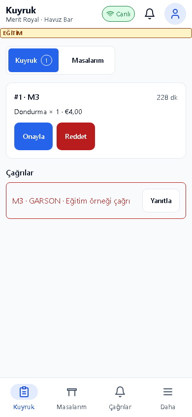
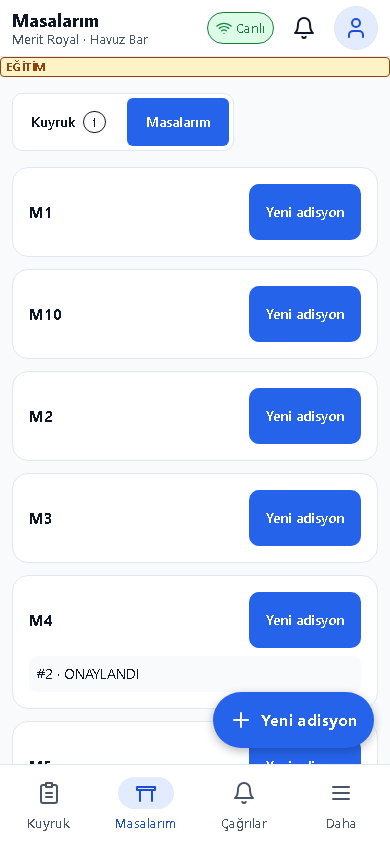
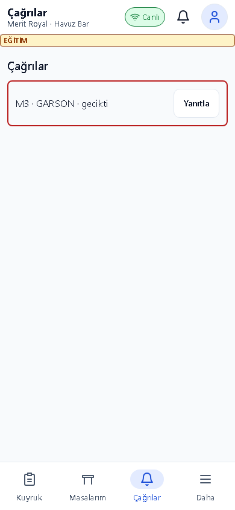
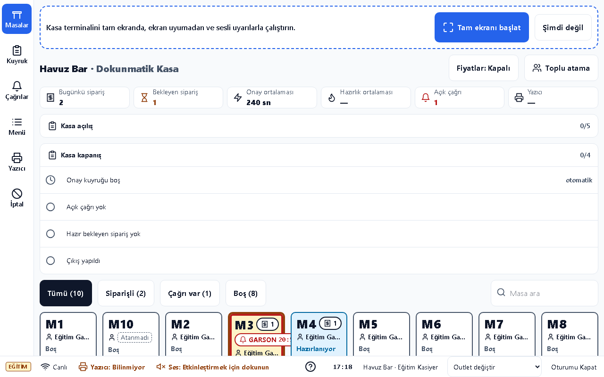
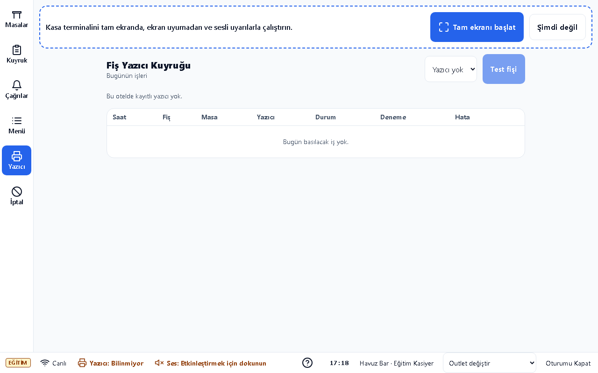
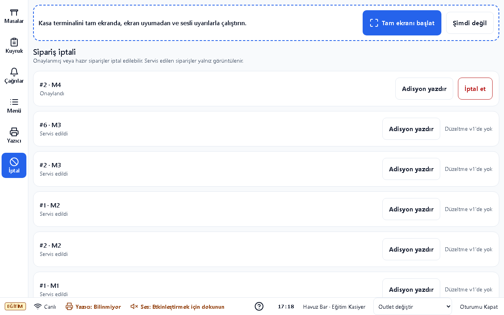

# Garson ve Kasa Kılavuzu

## Bu kılavuz kimin için

Masa siparişlerini onaylayan, hazırlık ve servisi izleyen garson/kasa personeli.

## Giriş

Eğitim ortamının adresini sorumlunuzdan alın; kurulum için [Kurulum kılavuzu](../kurulum.md) kullanılır. Bu belgedeki görüntüler ayrı eğitim veritabanındaki örnek verilerden alınmıştır. Gerçek kullanıcı/parola içermez.

Eğitim hesabı: egitim.garson1, egitim.kasa. Parolayı eğitim sorumlusu paylaşır; bu belgeye yazılmaz. Personel girişinde kullanıcı adı ve size verilen parola ile Giriş Yap düğmesine dokunun. Otel/hedef seçimi açılırsa doğru oteli ve çalışma yerini seçin. İş sonunda profil menüsünden çıkış yapın.

## Günlük işler

1. **Kuyruk**: Girişte Havuz Bar gibi doğru outleti seçin. Bekleyen siparişin masa, ürün ve adetlerini kontrol edin. Yetkiniz ve masa atamanız varsa onaylayın; uygun değilse gerekçesiyle reddedin. Onay öncesinde sipariş mutfak/yazıcıya gönderilmez.

2. **Masalarım**: Atanmış masalarınızı ve sipariş durumlarını izleyin. Hazır ürünü doğru masaya götürdükten sonra servis edildi adımını kaydedin. Kendi masanız olmayan siparişin onay yetkisi için kasayla görüşün.

3. **Çağrılar**: Garson çağrısının masa ve saatini kontrol edin, masaya ulaştığınızda çağrıyı tamamlayın. Profil menüsünde outlet değiştirme ve ses/bildirim seçeneklerini kullanın; tarayıcı izni ayrıca gerekir.

4. **Outlet Kasa Ekranı**: Masa panosundan dolu masayı açın. Masa atamasında ilgili garsonu seçin; toplu atamada seçilen masaları kontrol edin. Kuyruk ve çağrıları izleyin. Yanlış siparişte yetkiniz varsa gerekçeli iptal uygulayın.

5. **Fiş Yazıcı Kuyruğu**: Hatalı işi ve yazıcı durumunu inceleyin. Fiziksel fiş basılıp basılmadığını kontrol ettikten sonra yeniden basın; aynı fişi iki kez mutfağa iletmeyin. Yazıcı çevrimdışıysa IT/gateway sorumlusuna bildirin.

6. **İptal / Düzeltme**: Siparişin masa, ürün ve durumunu doğrulayın. İptal gerekçesini açık yazın. Tükendi işareti ve sipariş alımını kapatma yalnız yetkili menü yönetimi işlemleridir; kapanışta yeni sipariş kesilir, mevcut işler takip edilir.

## Sık sorunlar

| Sorun | Çözüm |
|---|---|
| Onay düğmesi kullanılamıyor | Doğru outleti, rolünüzü ve masa atamasını kasayla kontrol edin. |
| Fiyat görünmüyor | Otelin fiyat gösterimi kapalı olabilir; bu bir arıza değildir. |
| Fiş gelmiyor | Yazıcı kuyruğunu ve cihazı kontrol edin; yeniden basmadan önce mutfakla konuşun. |
| Bildirim sesi yok | İlk etkileşimi ve tarayıcı bildirim/ses izinlerini kontrol edin. |

## Hızlı kart

- Masa ve adetleri doğrula → onay → mutfak → hazır → servis.
- İptal/yeniden basmada gerekçe ve fiziksel durumu kontrol et.
- Outlet değiştirirken açık işlerini devret.

## Terimler

Kuyruk; Masalarım; Çağrılar.
