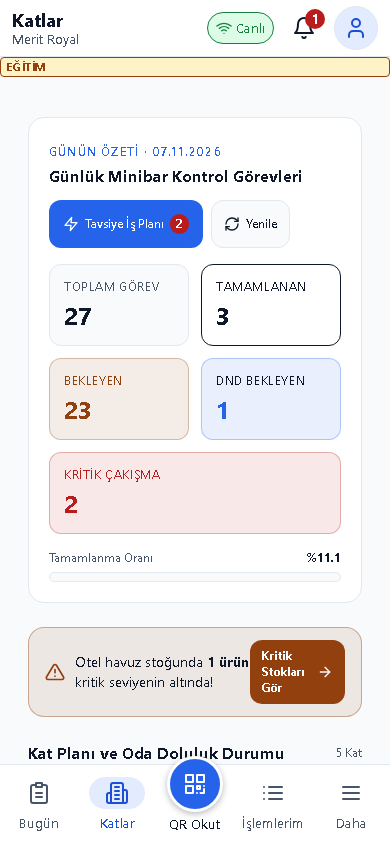
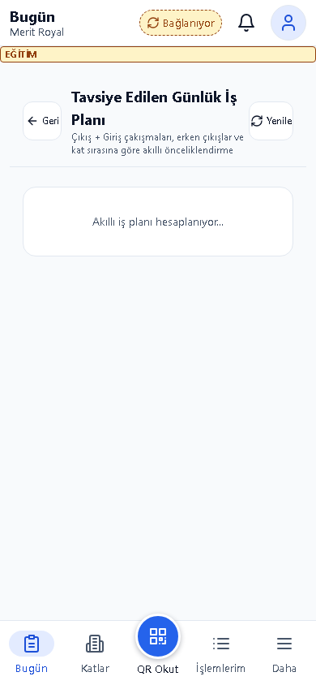
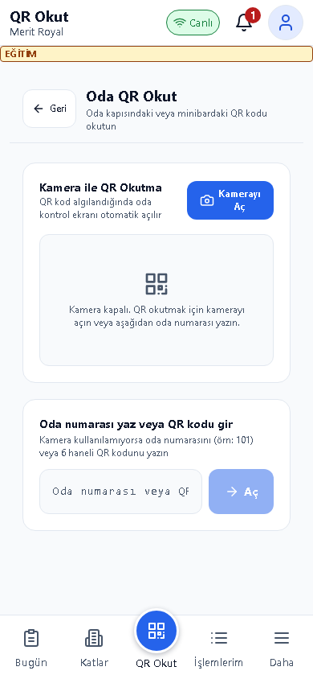
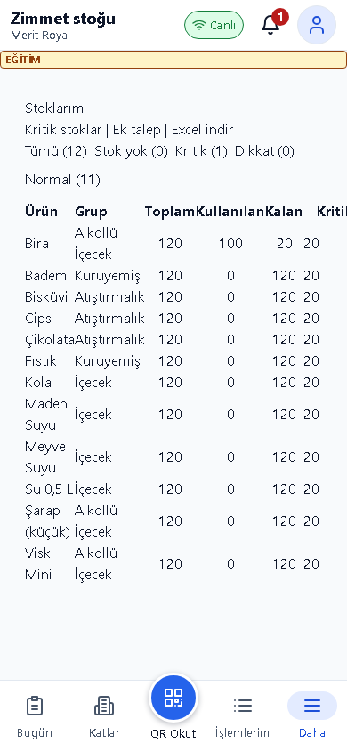
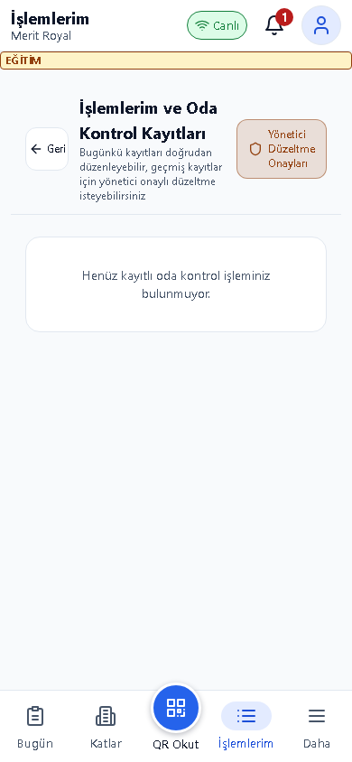
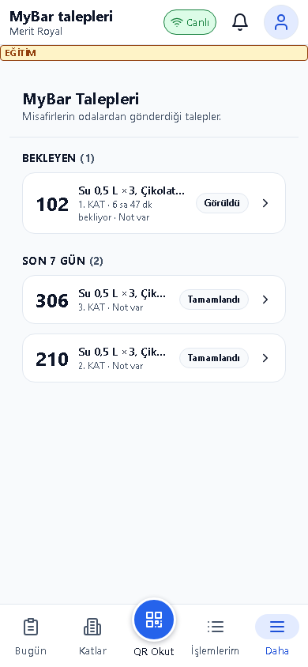

# Kat Sorumlusu Kılavuzu

## Bu kılavuz kimin için

Minibar oda kontrolü ve MyBar karşılama yapan saha personeli.

## Giriş

Eğitim ortamının adresini sorumlunuzdan alın; kurulum için [Kurulum kılavuzu](../kurulum.md) kullanılır. Bu belgedeki görüntüler ayrı eğitim veritabanındaki örnek verilerden alınmıştır. Gerçek kullanıcı/parola içermez.

Eğitim hesabı: egitim.kat2. Parolayı eğitim sorumlusu paylaşır; bu belgeye yazılmaz. Personel girişinde kullanıcı adı ve size verilen parola ile Giriş Yap düğmesine dokunun. Otel/hedef seçimi açılırsa doğru oteli ve çalışma yerini seçin. İş sonunda profil menüsünden çıkış yapın.

## Günlük işler

1. **Kat Planı**: Otelinizi ve katınızı kontrol edin. Kat kartına dokunun, oda doluluğunu ve yapılacak işleri okuyun. Oda numarasını doğrulamadan kayıt göndermeyin.

2. **Bugün**: Öncelik planındaki sırayı izleyin. Odaya geldiğinizde QR veya oda listesinden Oda Kontrolü açın. Eksilen ürünün ikame adedini + ile artırın. Sayılar o an eklediğiniz ürünü gösterir; setup sınırını aşamaz. Kaydetmeden oda ve ürünleri tekrar kontrol edin.

3. **QR Okut**: Tarayıcı sorarsa kamera izni verin ve oda QR kodunu okutun. Kamera açılmıyorsa Katlar üzerinden odayı seçin. Sarfiyat yoksa Sarfiyat Yok işlemini kullanın; DND odasında DND kaydedin. DND ikinci kontrolle tamamlanır; varsayılan 120 dakika hatırlatması ve gün sonu eksik kontrolü vardır.

4. **Zimmet stoğu**: Otelin ortak zimmet havuzunu ve kritik ürünleri kontrol edin. Eksik ürün için Düzeltme ve ek talepler bölümünden talep oluşturun; elinizde bulunmayan ürünü karşılandı olarak yazmayın.

5. **İşlemlerim**: Gönderdiğiniz oda kontrolünü, günü ve ürün adedini doğrulayın. Hatalı kayıt için yetkili sorumluya bildirin; ikinci bir kontrolle gizlemeye çalışmayın.

6. **MyBar talepleri**: Yeni talebin zorunlu onay penceresini okuyup kabul edin. Odaya gidin, gerçekten teslim edilen adetleri yazın. Eksik ürünle kapatmada gerekçe zorunludur. İptal işlemi depo/yönetim yetkisindedir. Profil menüsünden bildirim iznini ve tarayıcının Ana ekrana ekle seçeneğini kullanabilirsiniz; bağlantı yokken yazma işlemleri gönderilemez.

## Sık sorunlar

| Sorun | Çözüm |
|---|---|
| Kamera açılmıyor | HTTPS bağlantısını ve tarayıcı kamera iznini kontrol edin; Katlar yolunu kullanın. |
| Ürün adedi kabul edilmiyor | Setup sınırı ve ortak havuz bakiyesini kontrol edin. |
| Talep kapanmıyor | Gerçek teslim adedini ve eksik ürün gerekçesini doldurun. |
| Bildirim gelmiyor | Tarayıcı/site iznini, bağlantıyı ve doğru otel oturumunu kontrol edin. |

## Hızlı kart

- Odayı doğrula → +N / Sarfiyat Yok / DND seç → kaydı kontrol et.
- MyBar talebini oku → teslim et → gerçek adedi ve gerekçeyi kaydet.
- Vardiya sonunda İşlemlerim ve açık DND kayıtlarını gözden geçir.

## Terimler

Bugün; QR Okut; Zimmet stoğu; İşlemlerim; MyBar talepleri.
