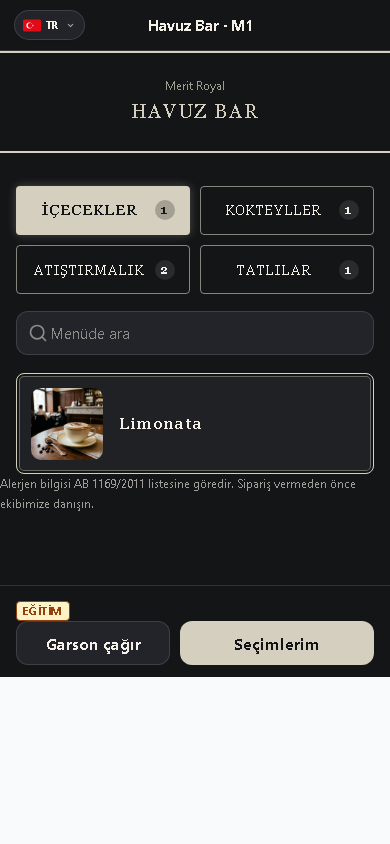
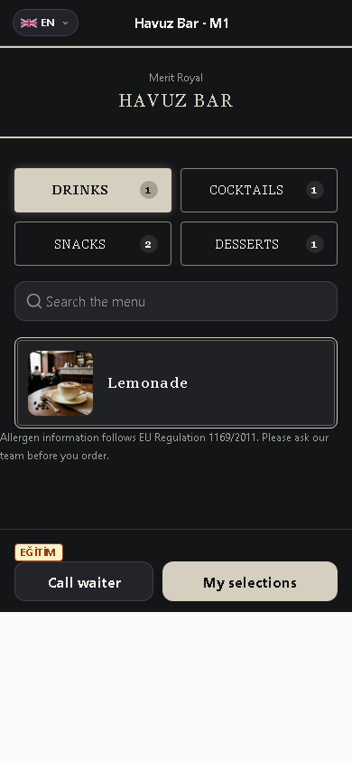
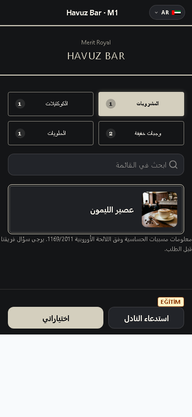
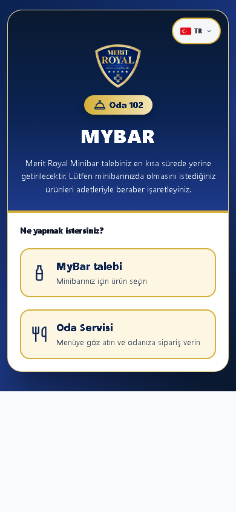
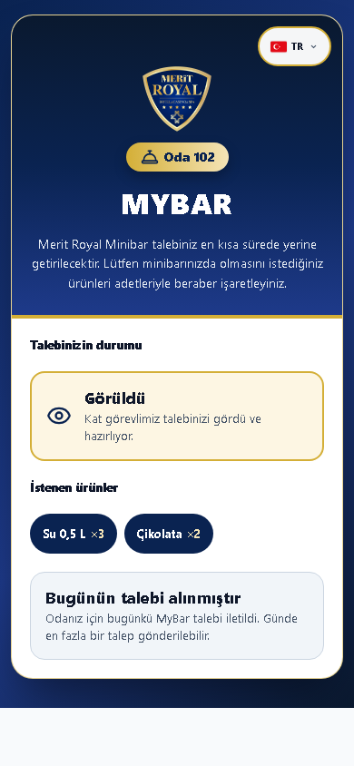
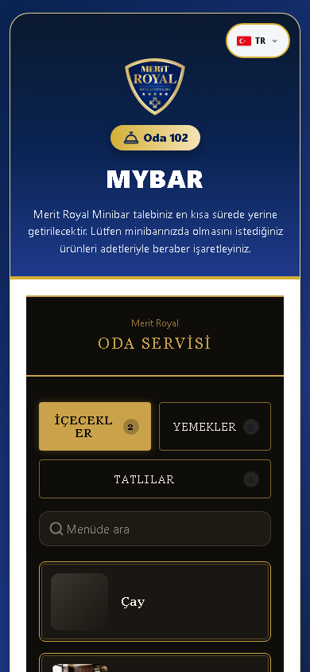

# Misafir Kılavuzu

## Bu kılavuz kimin için

QR menü, MyBar veya oda servisini kullanan misafirler ve bu akışı anlatan personel.

## Giriş

Eğitim ortamının adresini sorumlunuzdan alın; kurulum için [Kurulum kılavuzu](../kurulum.md) kullanılır. Bu belgedeki görüntüler ayrı eğitim veritabanındaki örnek verilerden alınmıştır. Gerçek kullanıcı/parola içermez.

Eğitim hesabı: Personel girişi gerekmez; eğitimde yalnız demo QR kodu kullanılır.. Parolayı eğitim sorumlusu paylaşır; bu belgeye yazılmaz. Personel girişinde kullanıcı adı ve size verilen parola ile Giriş Yap düğmesine dokunun. Otel/hedef seçimi açılırsa doğru oteli ve çalışma yerini seçin. İş sonunda profil menüsünden çıkış yapın.

## Günlük işler

1. **Misafir Menü Görünümü**: Telefon kamerasıyla masanızdaki QR kodunu okutun ve bağlantıyı açın. Menüde kategori ve ürünleri inceleyin; alerjen bilgisini okuyun. Ürünü ekleyince Seçimler bölümünden adetleri kontrol edin, siparişi gönderin. Onay ve hazırlanma durumunu açılan sayfadan takip edin. Garson çağırma seçeneğiyle masanıza personel isteyebilirsiniz.

2. **İngilizce menü**: Dil düğmesinden Türkçe, English, Deutsch, Русский veya العربية seçin. Çevrilmemiş ürün metni varsayılan dilde kalabilir; alerjen sorularınızı personele iletin.

3. **Arapça menü**: Arapça seçildiğinde sayfa sağdan sola görünür. Ürün ve adetleri göndermeden önce tekrar kontrol edin. Fiyat görünmüyorsa otel fiyat gösterimini kapatmış olabilir.

4. **Oda sayfası**: Odanızdaki QR kodunu okutun ve ekranda oda numarasını doğrulayın. Açık hizmetlere göre MyBar ve Oda Servisi seçenekleri görünür. Başka odanın QR kodunu kullanmayın.

5. **MyBar**: İstediğiniz ürün ve adetleri +/− ile seçip gönderin. Varsayılan günlük sınır oda başına bir taleptir; otel ayarı farklı olabilir. Durumu aynı sayfadan izleyin. Eksik teslim veya iptal için personele başvurun.

6. **Oda Servisi**: Ürünleri seçip adetleri doğrulayın ve siparişi gönderin. Otel telefon teyidi istiyorsa odanızdan aranabilirsiniz. Durum sayfasında hazırlık ve teslimi takip edin; vazgeçme seçeneği yalnız izin verilen aşamada görünür.

## Sık sorunlar

| Sorun | Çözüm |
|---|---|
| Sipariş alınmıyor | Menü açık olsa bile yeni sipariş alımı kapalı olabilir; personele başvurun. |
| Fiyat görünmüyor | Bu otelin fiyat gösterim tercihidir; personelden bilgi isteyin. |
| Oda sayfası açılmıyor | Odanızdaki QR kodunu tekrar okutun, interneti kontrol edin; resepsiyona bildirin. |
| İkinci MyBar talebi gönderilemiyor | Odanızın günlük talep sınırına ulaşılmış olabilir; kat sorumlusuyla görüşün. |

## Hızlı kart

- QR okut → oda/masa doğrula → dil seç → Seçimler → gönder.
- Sipariş durum sayfasını açık tut.
- Sorunda masa/oda ve sipariş numarasını personele söyle.
- Bu sayfayı tarayıcının Yazdır seçeneğiyle kağıda veya PDF olarak alabilirsiniz.

## Terimler

İngilizce menü; Arapça menü; Oda sayfası; MyBar; Oda Servisi.
