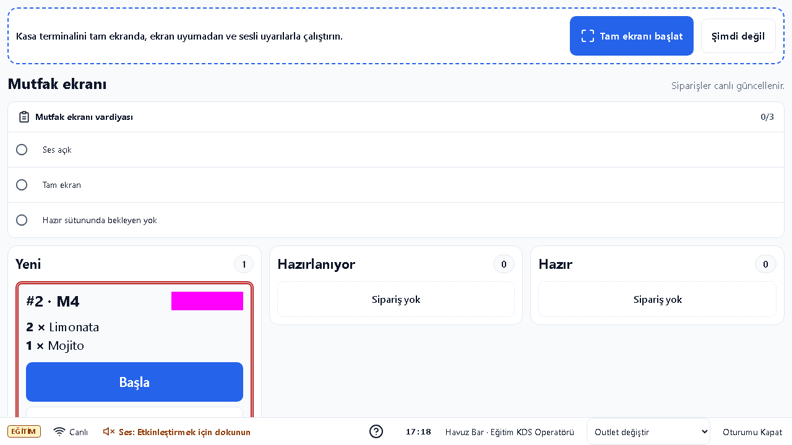
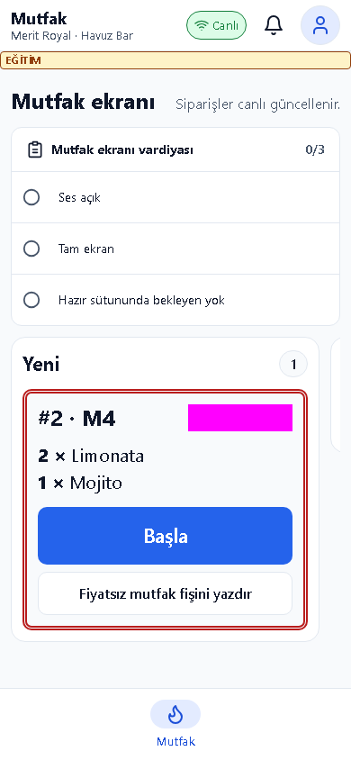
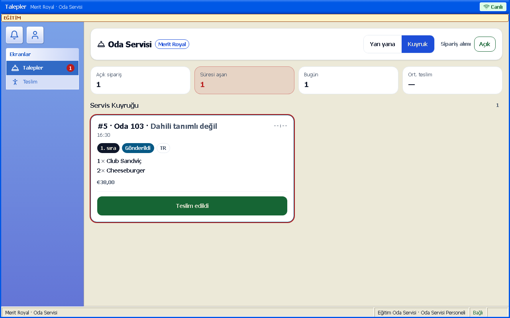
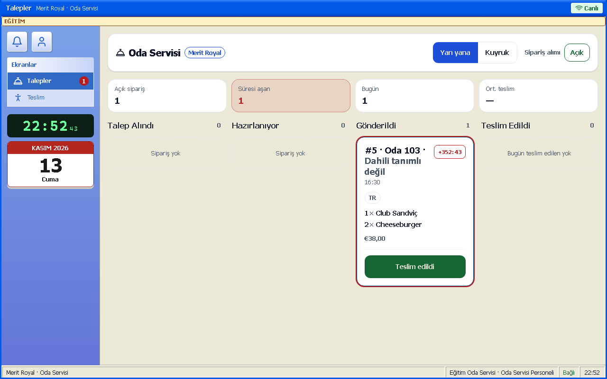
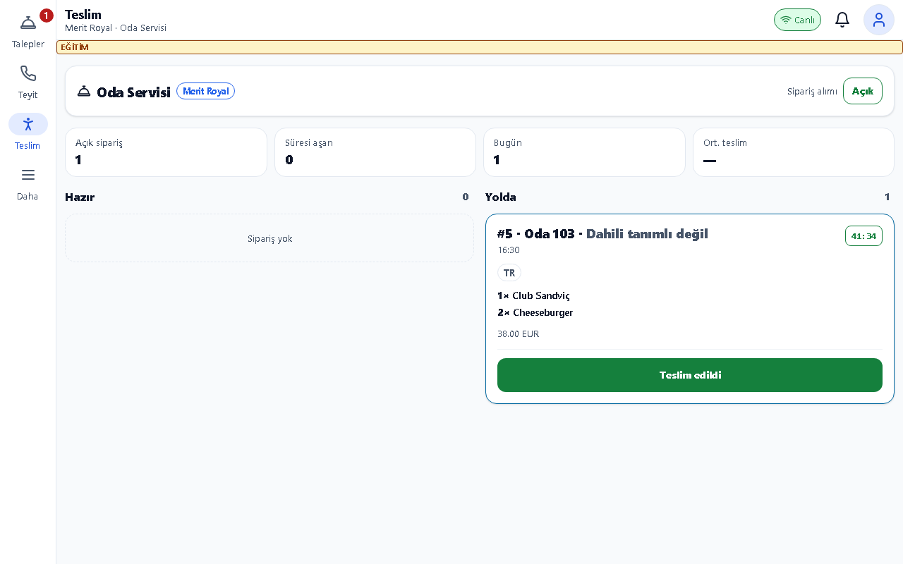
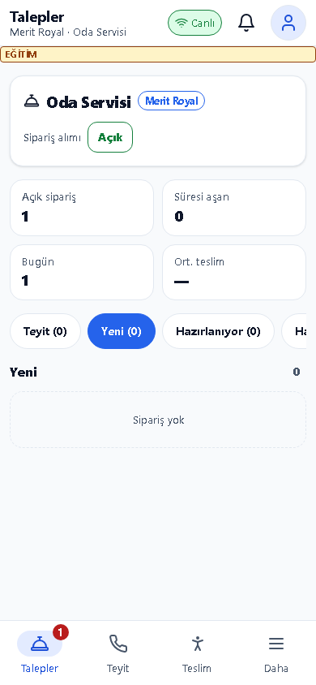

# Mutfak ve Oda Servisi Kılavuzu

## Bu kılavuz kimin için

KDS operatörü, mutfak şefi ve oda servisi personeli.

## Giriş

Eğitim ortamının adresini sorumlunuzdan alın; kurulum için [Kurulum kılavuzu](../kurulum.md) kullanılır. Bu belgedeki görüntüler ayrı eğitim veritabanındaki örnek verilerden alınmıştır. Gerçek kullanıcı/parola içermez.

Eğitim hesabı: egitim.kds, egitim.oda. Parolayı eğitim sorumlusu paylaşır; bu belgeye yazılmaz. Personel girişinde kullanıcı adı ve size verilen parola ile Giriş Yap düğmesine dokunun. Otel/hedef seçimi açılırsa doğru oteli ve çalışma yerini seçin. İş sonunda profil menüsünden çıkış yapın.

## Günlük işler

1. **Outlet Mutfak Ekranı**: Doğru outleti seçin. Yeni sütunundaki onaylanmış siparişleri masa, ürün, adet ve notuyla okuyun. Süre renkleri beklemeyi gösterir; uzun bekleyen işi önceliklendirin.

2. **Mutfak ekranı telefonda**: İşi alırken Başla, tamamlayınca Hazır adımını kaydedin. Fişte sipariş numarası, masa, ürün ve notu eşleştirin. Ses/tam ekran kontrolleri yalnız bu cihaz içindir. Oda servisi siparişleri ayrı operasyon ekranındadır.

3. **Oda Servisi Talepleri**: Oda numarası ve dahili telefonu kontrol edin. Yeni siparişler Talep Alındı sütununa gelir; Onayla ile hazırlığa gönderin. Hazırlanıyor, Hazır ve Yolda adımlarını gerçek duruma göre ilerletin. SLA sayacı gecikmeyi gösterir.

4. **Oda Servisi Talepleri** (yan yana görünüm): Görünüm düğmesinden Yan yana seçildiğinde talepler Talep Alındı, Hazırlanıyor, Gönderildi ve Teslim Edildi sütunlarında gösterilir. Kuyruk görünümüne aynı düğmeyle dönün.

5. **Teslim Takibi**: Yola çıkan siparişi doğru odaya götürün. Fiziksel teslimin ardından teslim adımını kaydedin. Oda boş görünüyor rozeti varsa doluluk bilgisini resepsiyonla doğrulayın; rozeti otomatik iptal saymayın.

6. **Oda servisi telefonda**: Sahada sipariş numarası ve oda bilgisini ekrandan izleyin. Gecikme uyarısını sorumluya bildirin. Sipariş alımını kapatma yalnız yetkili kişice yapılır; yeni işler kapanırken mevcut siparişler tamamlanır.

## Sık sorunlar

| Sorun | Çözüm |
|---|---|
| Sipariş KDS içinde yok | Önce kasa/garson onayını ve doğru outleti kontrol edin; oda servisi için ayrı ekranı açın. |
| Sayaç kırmızı | Gerçek durumu güncelleyin; SLA gecikmesini vardiya sorumlusuna bildirin. |
| Oda boş görünüyor | Resepsiyonla doluluğu ve oda numarasını doğrulayın. |

## Hızlı kart

- KDS: Yeni → Başla → Hazır.
- Oda servisi: gerekirse telefon teyidi → hazırlanıyor → hazır → yolda → teslim.
- Her adımı gerçekleştiği anda kaydet.

## Terimler

Mutfak ekranı telefonda; Oda servisi telefonda.
