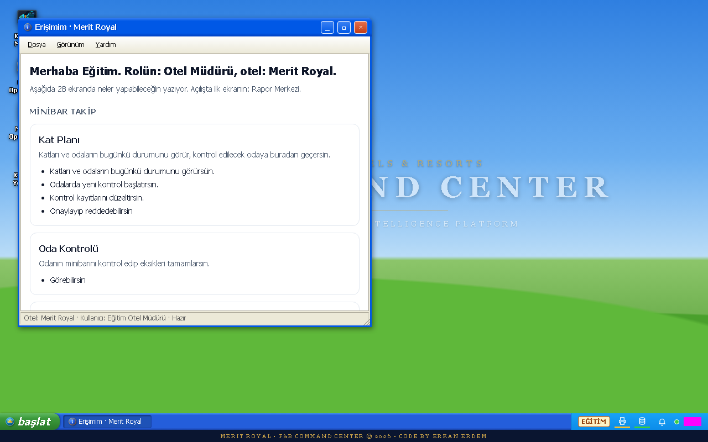
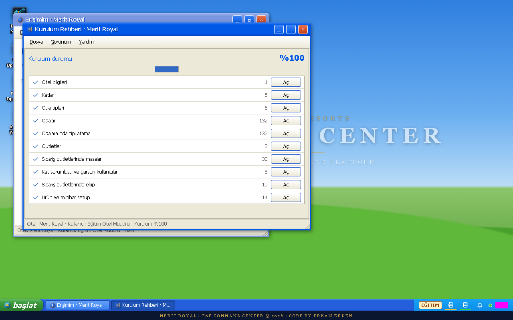
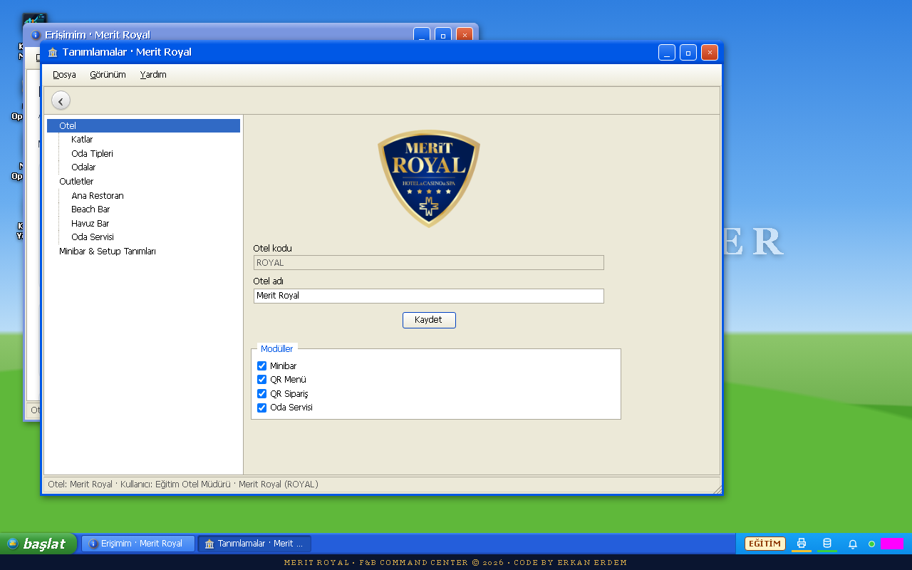
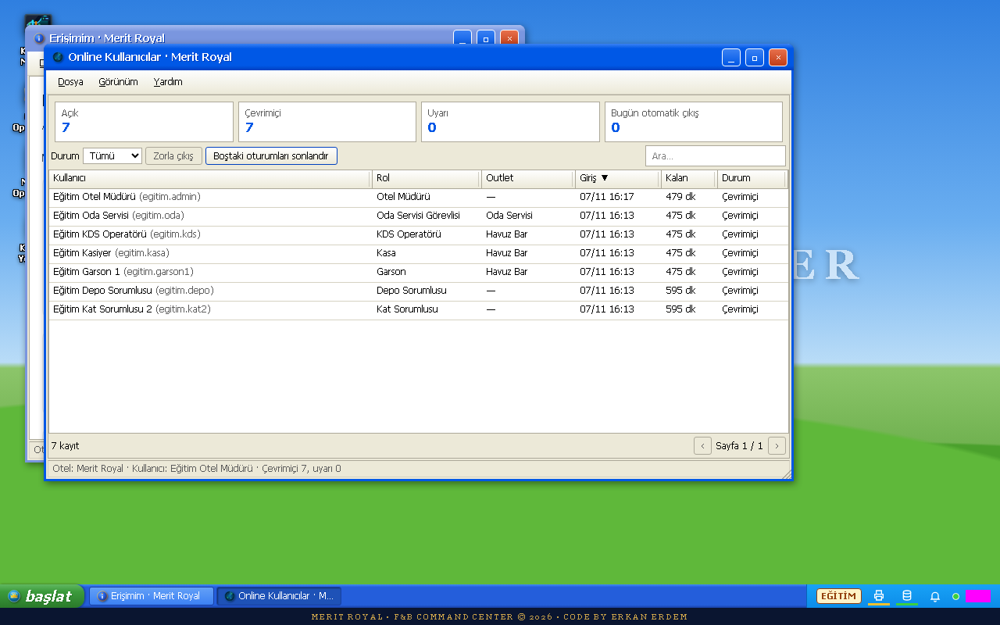
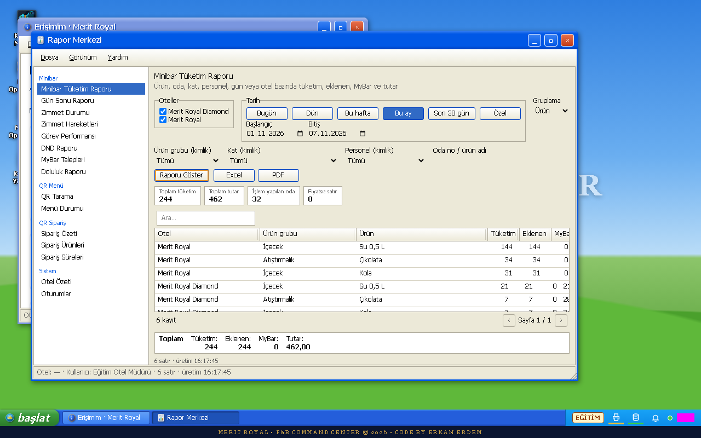
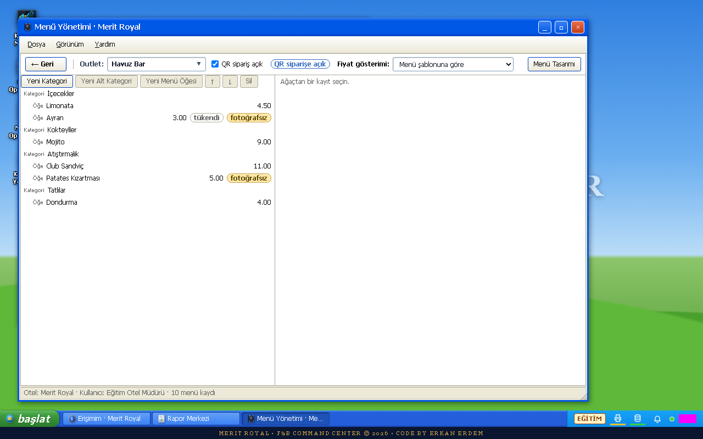
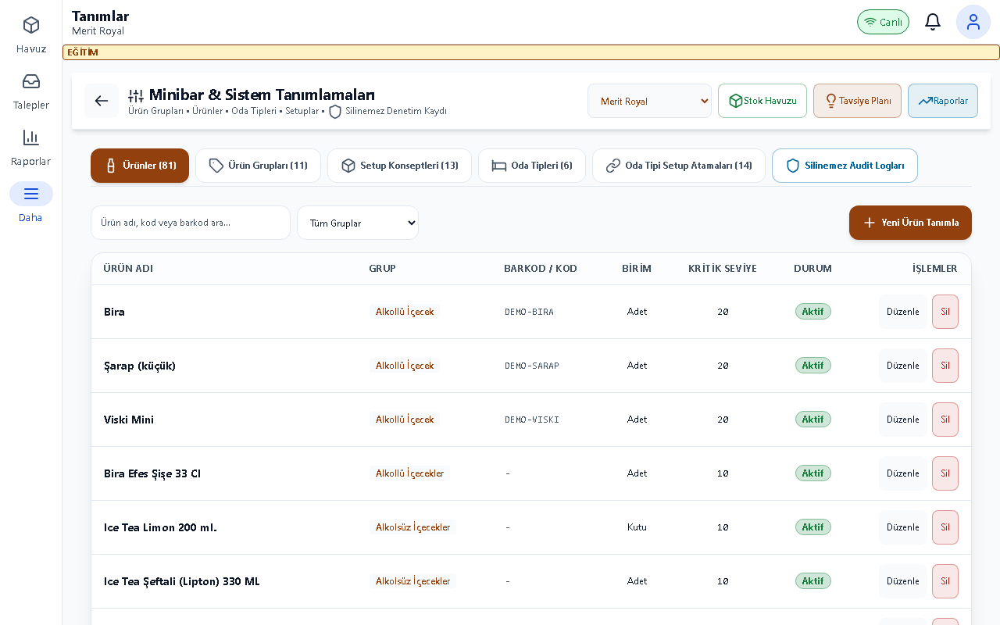
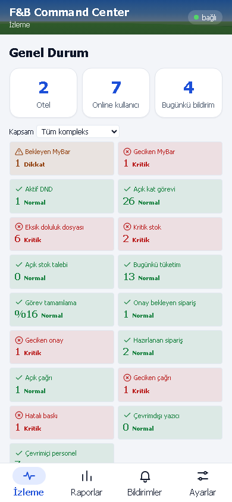

# Yönetici Kılavuzu

## Bu kılavuz kimin için

Otel müdürü, F&B müdürü ve yetkili sistem/IT personeli. Ekranlar rolünüze göre değişir; görünmeyen bir işlem için Erişimim üzerinden yetkinizi kontrol edin.

## Giriş

Eğitim ortamının adresini sorumlunuzdan alın; kurulum için [Kurulum kılavuzu](../kurulum.md) kullanılır. Bu belgedeki görüntüler ayrı eğitim veritabanındaki örnek verilerden alınmıştır. Gerçek kullanıcı/parola içermez.

Eğitim hesabı: egitim.admin. Parolayı eğitim sorumlusu paylaşır; bu belgeye yazılmaz. Personel girişinde kullanıcı adı ve size verilen parola ile Giriş Yap düğmesine dokunun. Otel/hedef seçimi açılırsa doğru oteli ve çalışma yerini seçin. İş sonunda profil menüsünden çıkış yapın.

## Günlük işler

1. **Merit OS masaüstü**: Otel/hedef seçiminizi doğrulayın. Başlat menüsünde uygulama adını arayın; masaüstü simgesini çift tıklayarak pencere açın. Pencerenin üst çubuğundan küçültün veya kapatın.

2. **Kurulum Rehberi**: Merit Royal otelini seçin. Eksik tanım başlıklarını izleyin; otel, kat, oda tipi, oda, outlet ve masa sırasını tamamlayın. Sonra kullanıcı, ekip ve rol/yetki atamalarını gözden geçirin. Oteller sabittir; silinmez.

3. **Tanımlamalar**: Önce doğru oteli seçin. Ağacın ilgili dalında yeni kayıt açın, alanları doldurun ve kaydedin. Düzenleme/silmede açılan onayı okuyun. Bağlı kaydı olan tanım silinemez. Kullanıcıya yalnız ihtiyacı olan otel ve ekranları verin.

4. **Online Kullanıcılar**: Kişi ve otel bilgisini kontrol edin. Gerekiyorsa ilgili kişinin Zorla çıkış işlemini onaylayın; kişinin açık oturumu kapanır. Bildirimler alanından uyarıları okuyun. Denetim Günlüğü erişimi yalnız yetkili role açıktır.

5. **Raporlar**: Raporu, oteli ve tarih aralığını seçin. Listeyi inceleyin; Excel veya PDF indirin. Yetkinize göre yalnız kendi otelinizi ya da atanmış outletinizi görebilirsiniz. Komuta Merkezi ve Canlı Radar canlı operasyonu izlemek içindir.

6. **Menü Yönetimi**: Outleti seçin. Kategori ve öğeyi oluşturup çeviri, alerjen ve görselleri kontrol edin. Tükendi işareti ile QR sipariş açık anahtarı farklıdır: biri öğeyi, diğeri yeni siparişleri etkiler. Menü Tasarım Stüdyosu ile görünümü, Masa QR Kodları ile baskıyı yönetin. Yazıcılar ekranında yalnız test fişiyle cihazı doğrulayın.

7. **Minibar Tanımları**: Ürün grubu/ürün, setup ve oda tipi atamasını sırayla tamamlayın. Oda QR Kodları & Baskı üzerinden deneme QR basıp gerçek telefonda okutun. Minibar fiyatları iç rapor içindir. Sistem Ayarları yetkili sistem personelince yönetilir: fiyat görünürlüğü, MyBar günlük sınırı, DND eşikleri, SLA ve onay eskalasyonunu değişiklik öncesinde kaydedin. Misafir IP hız sınırı çarpanı ortak Wi-Fi trafiği içindir; ölçmeden değiştirmeyin.

8. **Android görünümü**: Dar ekranda İzleme, Raporlar, Bildirimler ve Ayarlar sekmelerini kullanın. Masaüstündeki tüm yönetim pencereleri mobilde bulunmayabilir. QR taban adresi kesinleşmeden toplu baskı yaptırmayın. Yedek, geri yükleme ve alan adı işleri için IT personeli kurulum kılavuzunu izler.

## Sık sorunlar

| Sorun | Çözüm |
|---|---|
| Bir ekran görünmüyor | Erişimim ile rol, otel ve ekran kapsamını kontrol ettirin. |
| Raporda veri yok | Otel/tarih ve iş gününü kontrol edin; henüz işlem yapılmamış olabilir. |
| QR yanlış adrese gidiyor | IT ile QR taban adresini kontrol edin; adres değiştiyse QR yeniden basılır. |
| Oda servisi ayarı görünmüyor | İlgili modülün otelde açık ve rolünüzün yetkili olduğunu doğrulatın. |

## Hızlı kart

- Doğru otel → tanımlar → ekip ve yetki → QR denemesi.
- Fiyat, onay ve SLA değişikliklerini vardiya ekibine bildirin.
- Excel/PDF raporunu tarih ve oteli kontrol ederek paylaşın.
- Yedek/geri yükleme: [Kurulum kılavuzu](../kurulum.md).

## Terimler

Merit OS masaüstü; Android görünümü; Minibar Tanımları; Menü Tasarım Stüdyosu; Masa QR Kodları; Oda QR Kodları & Baskı; Bildirimler; Yazıcılar.
